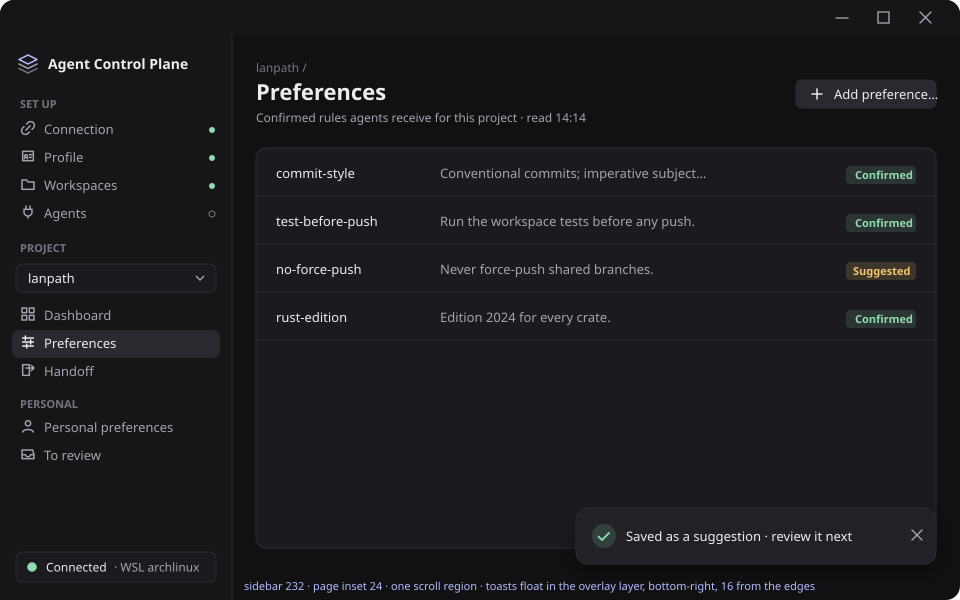
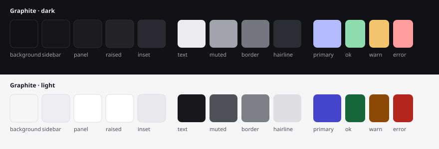

# ACP Operator design system

This is the visual and interaction system of the ACP Operator (Desktop, Web preview
and TUI). It turns the [NSH Design Guides](https://nsh.dev/docs/design-guides.md)
into this app's decisions: its tokens, its controls, its motion and its words.
Product behavior and authority rules live in the [UI standards](../../docs/product-ui.md);
where this file and that contract seem to disagree, the contract wins and the
disagreement is a bug to fix here.

Every screen is built from the app's `ui` layer (`src/ui/`). Colors come from
semantic tokens, geometry from `ui::scale`, motion from `ui::motion`, icons from
`ui::icons`. Raw color values exist only in `apps/core/src/appearance.rs` and in
the illustrations under `design/`.

## 1. Promise and personality

> **Open it, see where things stand, make the one decision that is waiting.**

ACP is a place developers return to for a minute at a time: to check the daemon is
up, to confirm a suggestion an agent made, to hand a task to the next session. The
interface earns that return visit by being *fast to read* and *pleasant to touch*.

| Quality | What it means on screen | What it rules out |
| --- | --- | --- |
| **Calm** | Graphite surfaces, one accent, hairlines instead of boxes, generous but regular spacing | Heavy outlines on every control, colored panels, alert banners for ordinary facts |
| **Certain** | Every state in words, the next action named, exact records before decisions | Spinners without labels, success claims ACP did not observe, color-only status |
| **Alive** | A live dot that breathes while the daemon answers, selections that slide, dialogs that rise, a check that grows in when a step completes | Ambient decoration, motion on data that ticks, entrance animations on every refresh |

Six working principles:

1. **The waiting decision is the focal point.** Each page has one primary object
   and at most one primary button. Counts of work waiting (suggestions to review)
   sit where the eye lands: the sidebar's trailing lane and the page header.
2. **Surfaces step, lines whisper.** Hierarchy comes from five surface steps and
   hairlines. Strong boundaries are kept for things you type into.
3. **Say the state, then show it.** Status is a word first; color, icon and motion
   reinforce it. The same word is used in the sidebar, header, toast and docs.
4. **Overlays float; pages never jump.** Toasts, menus, popovers, dialogs and
   sheets render in the overlay layer. Nothing that appears for a moment may push
   page content.
5. **Motion explains a change, once.** Every moving thing has a reason in the
   [motion inventory](#9-motion), uses a token, and stops under reduced motion.
6. **Finish every state.** Empty, loading, refused, unreachable and stale are
   designed screens with a next step, not blank space.

## 2. Who, where, and the primary tasks

The primary setup is a Windows Desktop window operating an ACP daemon that runs as
a systemd user service inside WSL2. The TUI and the offline Web preview share the
same semantics. Mobile is not a target.

Tasks, by how often they happen:

| Rank | Task | Where | Must be one step from |
| --- | --- | --- | --- |
| 1 | See whether the daemon answers and what it last read | Sidebar status row, page header | Every page |
| 2 | Review a suggestion and confirm or reject the exact record | To review, Preferences | Sidebar count, toast after saving |
| 3 | Add a preference (saved as a suggestion) | Preferences, Personal preferences | Page toolbar |
| 4 | Resume a task through Handoff | Handoff | Sidebar |
| 5 | Share a project with an agent (copy its MCP line) | Agents | Set-up step 4 |
| 6 | First-time setup: connection, Profile, workspaces, agents | Set up group | Dashboard empty state |

## 3. The shell

| Region | Size | Surface | Contents |
| --- | --- | --- | --- |
| Title bar | 36 high | `sidebar` above the sidebar, `background` above the page | Drag region, window caption buttons; the close button washes `danger` on hover |
| Sidebar | 232 wide (min 200, max 280) | `sidebar`, trailing hairline | Brand mark and name; **Set up**, **Project**, **Personal** groups; foot destinations; the status row |
| Page | the rest, inset 24 (12 when compact) | `background` | Header, page toolbar, one scroll region |
| Overlay layer | the window | — | Toasts (bottom-right, 16 from the edges), menus, popovers, dialogs, sheets |

**Sidebar rows.** 32 high, icon 16 in a fixed lane, label, and a trailing lane
for state: a success check once a set-up step is done (`✓` in a terminal). A count
belongs in that lane only when the daemon reports an exact total; one page of a
queue is not a count, and an uninspected queue is not zero. The current destination
has the `inset` fill; hover is a lighter wash. No leading bars. Group labels are
`CAPTION` semibold `muted`, never uppercased. Set-up steps keep stable spoken names
("Step 2: Profile") while their visible labels are just the step's name.

**Status row.** Pinned to the sidebar foot: an 8 pt dot and a short state word, then
the target (`Connected · WSL archlinux`). It is the persistent scope indicator for
the daemon target, and it is a button that opens **Connection**.

| State | Dot | Word | Motion |
| --- | --- | --- | --- |
| Ready, live | filled `success` | Connected / 已连接 | A ring pings out every 2.4 s |
| Reading | filled `warning` | Reading… / 读取中… | Breathes (pulse) |
| Offline preview | filled `muted` | Preview / 预览 | none |
| Unavailable | hollow `error` | Unreachable / 无法连接 | none |
| Refused | hollow `error` | Access refused / 访问被拒 | none |
| Task error | hollow `warning` | Needs attention / 需要处理 | none |

**Page header.** Title (20 pt semibold, a header role), an information button when
the page has a longer explanation, then one muted status line with the target and
last read. Page-wide actions sit at the trailing edge as small ghost buttons with
icons (Reconnect, Copy visible page). A page's own primary command (Add
preference…) lives in its toolbar, not in the header.

**Compact (< 900 wide).** The sidebar becomes a wrapped destination row above the
page, group labels and the brand hide, the status row stays, and dialogs keep a
16 pt margin from the window edges.

## 4. Color

Themes change color only; geometry, type and data never vary. Every theme has
light, dark and high-contrast forms. **Graphite** is the default.

| Theme | Character |
| --- | --- |
| Graphite | Neutral near-black (or paper-white) with an iris accent. The quietest; the default |
| Harbor | Deep navy with a periwinkle accent |
| Ledger | Warm paper and walnut with a terracotta accent |
| Instrument | Green-black with a mint accent |

### Roles

| Role | Use | Never |
| --- | --- | --- |
| `background` | The page floor | Cards or controls |
| `sidebar` | Sidebar and the title bar above it | Content surfaces |
| `panel` | Cards, lists, input fills | Floating layers |
| `raised` | Everything that floats: dialogs, sheets, toasts, menus, popovers | Base regions |
| `inset` | Control fills, the selected row, a pressed wash's base | Large areas |
| `text` | Body and titles | — |
| `muted` | Secondary text, help, group labels, idle icons | The only cue for a state |
| `border` | Boundaries you interact with: inputs, the focused control (≥ 3:1) | Decorative separators |
| `hairline` | Card edges, dividers, the sidebar edge, default button edges | Inputs (too faint to find) |
| `primary` / `on_primary` | The one emphasized commitment, focus rings, selection accents, counts of waiting work | Decoration, links that are commands |
| `success` | Observed and confirmed: connected, step done, applied | "Agent says it passed" |
| `warning` | Needs attention soon: reading, suggested, writes off | Errors |
| `error` | Failed, refused, unreachable | Destructive commitments |
| `danger` / `on_danger` | Destructive commitments (Delete, Remove) and the window close hover | Error text |

Rules:

- **Accent budget.** On one screen: one primary button, the focus ring, and at most
  one counted badge group. If more things look accented, demote them.
- **Washes are derived, never new colors.** `mix(base, text, t)` for neutral washes
  (`wash::HOVER` 6%, `wash::PRESS` 12%; selected = `inset`) and
  `role.opacity(tint::REST)` (14%) for tinted fills: badges and icon discs.
- **Status is never color alone.** Each status color travels with a word and,
  where there is room, an icon of a distinct shape (check, triangle, circle-x).
- **Contrast is tested.** `appearance.rs` asserts 4.5:1 for every text role on every
  surface, 3:1 for `border`, and 4.5:1 for `on_primary` and `on_danger`.
  `hairline` is decorative and exempt; nothing meaningful is drawn with it alone.

## 5. Typography

The platform UI font (Segoe UI on Windows) for interface text; monospace only for
identifiers (keys, digests, task IDs, paths), shortcuts and aligned numbers.

| Token | Size | Weight | Use |
| --- | --- | --- | --- |
| `CAPTION` | 12 | 400 / 600 | Help, metadata, badges, group labels |
| `BODY` | 14 | 400 / 500 | Body, control labels, rows |
| `SUBTITLE` | 16 | 600 | Dialog and sheet titles, brand name |
| `TITLE` | 20 | 600 | Page titles |
| `DISPLAY` | 22 | 600 | Reserved for a hero title; not used on current screens |

At most three sizes and two weights per screen. Secondary text uses `muted`, not a
smaller size alone. Nothing below 12 for reading. Sentence case in English; no
`text-transform` on Chinese.

## 6. Space, radius, elevation

Spacing uses the 4-point Tailwind scale by relationship: 4 inside a control, 8
between related controls, 12 inside a group, 16 between groups and as card
padding, 24 between sections and as page and dialog padding, 32 around empty states.

| Radius token | Value | Use |
| --- | --- | --- |
| `SMALL` | 4 | Badges, small buttons, segment fills |
| `CONTROL` | 6 | Buttons, inputs, rows, tabs |
| `CONTAINER` | 10 | Cards, lists, popovers, menus, theme cards |
| `OVERLAY` | 12 | Dialogs and toasts |
| `PILL` | full | Status dots and icon discs |

| Level | Surface | Edge | Shadow |
| --- | --- | --- | --- |
| 0 floor | `background`, `sidebar` | hairline between regions | none |
| 1 content | `panel` | hairline | none |
| 2 anchored | `raised` (menu, popover) | hairline | `shadow_lg` |
| 3 modal | `raised` (dialog, sheet, toast) | hairline | `shadow_xl`, scrim 50% black under modals |

## 7. Iconography

One family: original outline vectors on a 24 grid, stroke 1.6, round caps and
joins, `currentColor`, defined in `src/ui/icons.rs`. Sizes: 14 in small controls,
16 by default, 20 in toasts and dialog headers, 24 in empty states (inside a 48
tinted disc). Icons supplement labels; an icon-only control always has an
accessible name and, when its meaning is not universal, a tooltip. In a terminal
icons are hidden and labels (and `✓`) carry the meaning.

| Icon | Meaning | Used in |
| --- | --- | --- |
| `BRAND` (three planes and a node) | Agent Control Plane | Sidebar brand, this file |
| `CONNECTION` (link) | Daemon connection | Set up 1 |
| `PROFILE` (card) | The Profile | Set up 2 |
| `WORKSPACES` (folder) | Projects (workspaces) | Set up 3 |
| `AGENTS` (plug) | Agents reading through MCP | Set up 4 |
| `DASHBOARD` (four tiles) | Project dashboard | Project |
| `PREFERENCES` (sliders) | Preferences | Project, Personal |
| `HANDOFF` (page with arrow) | Handoff | Project |
| `SESSIONS` (terminal) | Agent sessions | Project |
| `PERSON` | Personal scope | Personal preferences |
| `REVIEW` (inbox) | Suggestions waiting | To review |
| `DIAGNOSTICS` (pulse) | Diagnostics | Foot |
| `SETTINGS` (sliders) | Settings | Foot |
| `REFRESH` | Re-read | Reconnect |
| `COPY` | Copy text | Copy visible page |
| `PLUS` | Add something | Add preference dialog header |
| `CHECK` | Done, confirmed | Step done, theme chosen, success toasts, Apply dialog |
| `ALERT` (triangle) | Consequential decision | Destructive Apply dialog |
| `ERROR` (circle-x) | Failed or refused | Error toasts |
| `INFO` (circle-i) | More explanation | Page information button, info toasts |
| `CLOSE` (x) | Dismiss | Toasts |
| `TRASH` | Destructive removal | Delete preference, Remove project dialogs |
| `LOCK` / `UNLOCK` / `SEARCH` | Writes off / on, filter | Reserved for Profile writes and filters |

Section icons (dashboard, preferences, handoff, diagnostics, workspaces) come from
`icons::section_path`; the rest are named constants in `icons.rs`.

## 8. Components

The `ui` layer is the only place that styles `nsh/base`. A feature that needs a new
look adds a variant here first. Run the gallery (`ACP_UI_GALLERY=1`) to see every
control in every variant, size and state in light and dark.

### Sizes

| Size | Height | Text | Icon | Padding x | Radius |
| --- | --- | --- | --- | --- | --- |
| Small | 24 | 12 | 14 | 8 | `SMALL` |
| Medium (default) | 32 | 14 | 16 | 12 | `CONTROL` |
| Large | 40 | 16 | 16 | 16 | `CONTROL` |

Compact layouts tighten padding, never height.

### Controls

| Component | Variants and states | Notes |
| --- | --- | --- |
| `button` | Default (inset fill, hairline edge), Primary, Danger, Ghost; selected, disabled, loading; `leading` and `trailing` slots | 1 pt edge, label centered in the frame. Focus: the edge takes `primary` and a 2 pt `primary` ring sits outside it. Loading keeps width and shows a spinner beside the label |
| `icon_button` | Ghost square of the control height | Accessible name required (shown as text in a terminal); press scale 0.95 |
| `nav_item`, `step_item` | Ghost full-width rows, selected fill | `step_item` has the trailing done check |
| `input` | Medium, Large, multiline; invalid, disabled | `panel` fill, `border` edge, 12 inner padding; focus: `primary` (or `danger` when invalid) edge and a soft 3 pt ring |
| `markdown_input` | — | Same frame as `input`, full width; its height yields between 96 and 320 so its dialog fits the window |
| `field` | Label, control, help or error | Label 12 / 500; help directly under the control |
| `tabs`, `radio_group` | Segmented; selected | One silhouette; one selected fill |
| `menu`, `info` (popover) | — | `raised`, hairline, `CONTAINER`, `shadow_lg`; grow from the trigger |
| `dialog`, `alert_dialog` | Sizes S 400, M 520, L 640; optional header icon | See below |
| `sheet` | Trailing, 440 (360 compact) | `raised`; header, scrolling body, pinned footer |
| `toast` | Success, Info, Error | See below |
| `badge` | Neutral, Info, Success, Warning, Danger | Tinted fill, 12 / 600 |
| `status_dot` | Live, Busy, Idle, Down, Attention | Filled or hollow + color + motion, always with its word beside it; hidden from screen readers |
| `empty` | Optional icon and action | Icon in a 48 tinted disc; title 16 / 600; one action |
| `surface`, `card` | Optional title | `panel`, hairline, `CONTAINER`, padding 16 |
| `choice_card` | Selected | One option shown by its own preview (themes: "Aa" on the theme's floor with its accent and status dots), its name, a `primary` edge and a check when chosen |

### Dialog

- Width is chosen by the decision: **S 400** to confirm (alert dialogs), **M 520**
  for a short form or an Apply decision, **L 640** for a form with a rich value
  (Add preference). The panel is `w-full` with `max-w = size`, inside a 16 pt window
  margin, so it also fits a narrow window. On a short window the rich-value editor
  yields height (down to 96) instead of the dialog overflowing.
- Content always fills the panel's content width (`w-full`). A fixed-width child
  inside a dialog is a defect: it is how fields once reached past the panel's edge.
- Anatomy: optional 28 icon disc (`PLUS`/`CHECK` in the accent tone, `TRASH`/`ALERT`
  in the danger tone), title (16 / 600, a header role), description (`muted`, only
  new information), body with 16 between labeled fields, a hairline, then actions at
  the trailing edge: `Cancel` and the result verb. Padding 24.
- Focus moves to the first field when the modal is ready; Escape cancels; focus
  returns to the trigger.

### Toast

- Rendered in an `Overlay` at the bottom-right, 16 from the edges, 360 wide (less
  on a narrow window), in a pass-through region: **a toast never takes layout space**
  and never blocks clicks outside its own frame. A headless test holds this.
- `raised`, hairline, `OVERLAY` radius, `shadow_xl`; a 20 tone icon in a 28 tinted
  disc (check, circle-i, circle-x), the message, and a close icon button.
- Success and Info last 4 s, Error 8 s; hovering expands the stack and pauses them;
  at most 3 visible, older ones peeking behind; Escape dismisses the newest; a swipe
  right or the close button dismisses one.
- A toast reports an outcome that is already true. It never carries the only copy of
  something the user must act on (an uncertain write is an inline notice).

## 9. Motion

| Token | Value | For |
| --- | --- | --- |
| `INSTANT` | 120 ms | Hover wash, color change |
| `FAST` | 180 ms | Press, a control's state, scrim in |
| `BASE` | 240 ms | Selection sliding, glyph swap, popups and toasts leaving |
| `SLOW` | 360 ms | Dialogs and popups opening |
| `SLOWER` | 500 ms | A list's wave on page entry |
| `SETTLE` | cubic-bezier(0.22, 1, 0.36, 1) | Presses and entrances |
| Distances | 4 / 8 / 16 | Label rise / popup rise / toast slide |
| Scales | press 0.97, icon press 0.95, enter 0.97 | |

Every helper in `ui::motion` collapses to no motion under reduced motion: durations
become 0, scales rest at 1, pings and pulses stop, and every state is still readable.

### Motion inventory

Written before a screen's code; each line is checked in the running app before the
work is called done. "RM" is what reduced motion does.

**Shell (every page)**

| Change | Motion | RM |
| --- | --- | --- |
| Hover and press on a button or row | Wash and press share the control's transition: `FAST` on `SETTLE`; press scales to 0.97 (icon buttons 0.95) | Instant, no scale |
| Current destination changes | The old row's fill fades out as the new row's fades in (`FAST`) | Instant |
| Page changes | The page title arrives: fade and rise 4, `FAST`; page content swaps at once | Appears |
| Set-up step completes | Its trailing check pops in (scale 0.25 → 1, fade), `BASE` | Appears |
| Daemon answering | The status dot's ring pings out | Still dot |
| Reading | The status dot breathes | Still dot |
| Toast arrives / leaves | Rises 16 and fades in, `BASE` on `SETTLE`; leaves fading to 0.95 | Appears / disappears |
| Toast stack expands on hover | The NSH stack's critically damped springs | Instant |
| Window narrows past 900 | None; the layout follows the resize | — |

**Preferences, Personal preferences, To review**

| Change | Motion | RM |
| --- | --- | --- |
| Records list built | Rows arrive as a wave: rise 8 and fade, `SLOWER`, 50 ms apart, capped at the first 12 | Appear |
| Add preference… opens | Scrim fades in `FAST`; the panel grows from 0.97 and rises 8, `SLOW`, ease-out | Appears |
| Field focus | Edge to `primary` and the ring in, `INSTANT`, ease-out | Instant |
| Record sheet opens / closes | The NSH sheet's own presentation from the trailing edge, over a fading scrim | Appears |
| Decision prepared | The Apply dialog, as Add preference | Appears |
| Empty or loading list | The empty state arrives: rise 8 and fade, `SLOWER` | Appears |

**Settings**

| Change | Motion | RM |
| --- | --- | --- |
| Theme card chosen | Colors switch at once; the chosen card's check pops in, `BASE` | Check appears |
| Color mode or language segment | One selection fill slides to the chosen segment (NSH tabs indicator) | Instant |

**Connection, Profile, Workspaces, Agents**

| Change | Motion | RM |
| --- | --- | --- |
| Check / Start / Connect / Add running | The button dims, holds its width and shows a turning spinner; the label stays | Spinner rests |
| Result arrives | The result's text replaces the waiting text in place | — |

Sound: none. ACP is a quiet developer tool.

## 10. Words

Voice: plain, exact, calm. Name the object and the result. No "successfully", no
exclamation marks, no "Are you sure". Ellipsis (`…`) on commands that open a dialog
or need more input. Sentence case in English.

| Concept | English | 简体中文 | Never |
| --- | --- | --- | --- |
| The local service | daemon | Daemon | server, backend |
| Personal store | Profile | Profile | database, account |
| A checkout ACP knows | workspace / project | 工作区 / 项目 | repo (in UI copy) |
| An agent's proposal | suggestion | 建议 | request, ticket |
| Accept a suggestion | Confirm | 确认 | Approve, OK |
| Allowing Profile changes | Writes on / off | 写入已开启 / 已关闭 | permissions, admin |
| Daemon status | Connected, Reading…, Unreachable | 已连接、读取中…、无法连接 | Online, Healthy |

Errors say what happened and the next step: *"The WSL daemon is not reachable. Start
it inside WSL, then Reconnect."* Success toasts name the new state only when it is
not already visible.

## 11. Keyboard and accessibility

Every action is reachable by keyboard: Tab order follows the screen, arrows move
within groups, Enter and Space activate, Escape closes the top layer. Focus is
always visible (the `primary` ring) and returns to the trigger after an overlay.
Every icon-only control has a name; states (selected, disabled, busy, expanded) are
exposed, not only drawn. Shortcuts are listed in Settings → Keyboard and in the
[apps README](../README.md).

## 12. Platforms

| Family | Adaptation |
| --- | --- |
| Desktop (Windows HWND, Linux, macOS) | The design above. Own title bar; drag region; caption buttons from the theme |
| Web preview | Same design, synthetic data, no daemon |
| TUI | Whole cells; no radii, shadows or icons; `✓` and words carry state; 16 colors and monochrome; toasts become a framed line at the bottom; dialogs are framed boxes |

## 13. Where it lives

| Concern | File |
| --- | --- |
| Theme values and contrast test | `apps/core/src/appearance.rs` |
| Semantic palette and washes | `src/ui/tokens.rs` |
| Radii, type, sizes, layout widths | `src/ui/scale.rs` |
| Motion tokens and helpers | `src/ui/motion.rs` |
| Icon family | `src/ui/icons.rs`, `src/ui/icon.rs` |
| Controls | `src/ui/*.rs` |
| Gallery | `src/ui/gallery.rs` (`ACP_UI_GALLERY=1`) |
| Illustrations in this file | `design/*.svg` (documentation only; never loaded by the app) |

## 14. Done means

A screen change is finished when, in the running Desktop app in Graphite light and
dark: the NSH Design Guides' finishing checklist passes group by group; every line of
the screen's motion inventory was seen (and seen to stop under reduced motion); the
main task completes by keyboard alone; and nothing that appears for a moment moves
the page.
