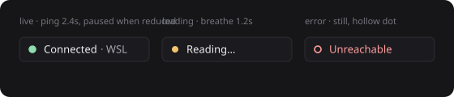
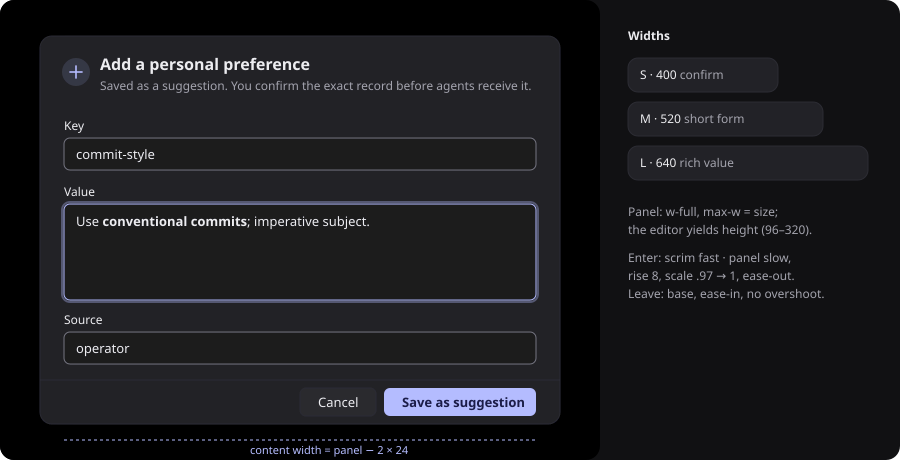
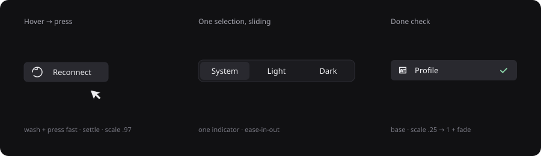

# Precept Operator design system

This is the visual and interaction system of the Precept Operator desktop app. It turns the [NSH Design Guides](https://nsh.dev/docs/design-guides.md)
into this app's decisions: its tokens, its controls, its motion and its words.
Product behavior and authority rules live in the [UI standards](../../docs/product-ui.md);
where this file and that contract seem to disagree, the contract wins and the
disagreement is a bug to fix here.

Every screen is built from the app's `ui` layer (`src/ui/`). Colors come from
semantic tokens, geometry from `ui::scale`, motion from `ui::motion`, icons from
`ui::icons`. Raw color values exist only in `apps/core/src/appearance.rs` and in
the illustrations under `design/`.

## 1. Promise and personality

> **Open it, see where things stand, make the one decision that is waiting.**

Precept is a place developers return to for a minute at a time: to check the daemon is
up, to confirm a suggestion an agent made, to hand a task to the next session. The
interface earns that return visit by being *fast to read* and *pleasant to touch*.

| Quality | What it means on screen | What it rules out |
| --- | --- | --- |
| **Calm** | Graphite surfaces, one accent, hairlines instead of boxes, generous but regular spacing | Heavy outlines on every control, colored panels, alert banners for ordinary facts |
| **Certain** | Every state in words, the next action named, exact records before decisions | Spinners without labels, success claims Precept did not observe, color-only status |
| **Alive** | A live dot that pings while the daemon answers, segment selections that slide, dialogs that rise, a check that grows in when a step completes | Ambient decoration, motion on data that ticks, entrance animations on every refresh |

Six working principles:

1. **The waiting decision is the focal point.** Each page has one primary object
   and at most one primary button. Work waiting (suggestions to review) has its own
   destination in the sidebar, and a count beside it once the daemon reports an
   exact total.
2. **Surfaces step, lines whisper.** Hierarchy comes from five surface steps and
   hairlines. Strong boundaries are kept for things you type into.
3. **Say the state, then show it.** Status is a word first; color, icon and motion
   reinforce it. The same word is used in the sidebar, header, toast and docs.
4. **Overlays float; pages never jump.** Toasts, menus, popovers, dialogs and
   sheets render in the overlay layer. Nothing that appears for a moment may push
   page content.
5. **Motion explains a change, once.** Every moving thing has a reason in the
   [motion inventory](#9-motion), uses a token, and stops under reduced motion.
6. **Finish every state.** Empty, loading, refused, unreachable and stale are
   designed screens with a next step, not blank space.

## 2. Who, where, and the primary tasks

The primary setup is a Windows Desktop window operating an Precept daemon that runs as
a systemd user service inside WSL2. There is no terminal or web interface; the
`precept` CLI covers headless use. Mobile is not a target.

Tasks, by how often they happen:

| Rank | Task | Where | Must be one step from |
| --- | --- | --- | --- |
| 1 | See whether the daemon answers and what it last read | Sidebar status row, page header | Every page |
| 2 | Review a suggestion and confirm or reject the exact record | Review | The sidebar, Dashboard, toast |
| 3 | Add a preference (saved as a suggestion) | Rules (`Personal` / `Project`) | Page toolbar, Preferences |
| 4 | Resume a task through Handoff | Handoff | Sidebar, Dashboard |
| 5 | Share a project with an agent (copy its MCP line) | Agents (under Set up, after Workspaces) | Sidebar, Dashboard |
| 6 | First-time setup: connection, Profile, one workspace, optional agent access | Independent launch guide; Runtime checks remains the reusable setup surface | First launch, Dashboard next-step card, Runtime checks |

### First-launch guide

The first launch without a saved connection opens a focused guide instead of the
workspace shell. It has one job: get the operator to a usable project without
making them learn the navigation first.

| Step | Required | Primary result | Reused workflow |
| --- | --- | --- | --- |
| 1 · Connection | Yes | A live daemon answers | Connection checks, Start and Connect |
| 2 · Profile | Yes | One private Profile is selected | Profile create/select and startup choice |
| 3 · Workspace | Yes | One existing Git checkout is registered | Folder check, explicit write grant and Add |
| 4 · Agent access | No | The selected workspace is shared, or the operator continues without sharing | Existing per-project agent switch |
| Done | — | A clear completion state before Dashboard | Open Dashboard |

- A 248-point rail names the four steps, their purpose and their observed state.
  One selection fill slides to the current step; completed steps show a check.
  A future step is disabled until the required steps before it are complete.
- The page keeps the app's own title bar and window buttons. **Skip setup** is a
  quiet, always-available action; it closes the guide and records only a
  presentation preference. It never creates a Profile, grants writes or changes
  a repository.
- The footer keeps **Back** and one primary continuation together. Continuation
  is disabled until the current required step is observed complete. The Agent
  step says it is optional and may be finished without sharing.
- **Reopen launch guide…** in Runtime checks starts at the first incomplete step.
  The Dashboard's next-step card uses the same observed order, so skipping never
  leaves the user without a route back.
- Connection, Profile and workspace actions keep their existing labels, guards,
  previews and error copy. The guide adds context, not a second write path.

## 3. The shell

| Region | Size | Surface | Contents |
| --- | --- | --- | --- |
| Title bar | 36 high | `sidebar` above the sidebar, `background` above the page | Drag region, window caption buttons; the close button washes `danger` on hover |
| Sidebar | 232 wide, the window's full height (a wrapped row below 900) | `sidebar`, trailing hairline | Brand mark and name; **Workspace** (with the app's single workspace switcher above Dashboard, Preferences, Sessions, Memory, Handoff), **Context** (`Review` with waiting count pill and `Rules` for reviewed records), **Set up** (`Runtime checks` with `✓` or `n/2` progress, then `Workspaces`, `Agents`, `Personal sync`); foot destinations; the status row and the keyboard button |
| Page | the rest, inset 24 (8 when compact); utility/review content at most 800 | `background` | Header, page toolbar, one scroll region |
| Overlay layer | the window | — | Toasts (bottom-right, 16 from the edges), menus, popovers, dialogs, sheets |

**Sidebar rows.** 32 high, icon 16 in a fixed lane, label, and a trailing lane
for state: on **Runtime checks**, a success check once both steps
(Connection and Profile) are ready or a tabular
`n/2` count while incomplete; on **Review**, a `primary` count
pill showing the daemon's exact count of suggested records (`profile.review.count`,
personal scope plus the selected project), read again when the target, project or
a decision changes. Unknown or refused hides the pill; zero hides it too, and
nothing ever shows "0" for "not counted". Its spoken name carries the count
("Review, 3 waiting"). One `inset` indicator behind the rows marks
the current destination and slides to it; hover is a lighter wash. No leading
bars. Group labels are `CAPTION` semibold `muted`, never uppercased.

**Resize grip.** A small grip in the window's bottom-right corner, drawn over the
page; it takes no row, so the sidebar reaches the bottom edge.

**Status row.** Pinned to the sidebar foot, beside a square keyboard button that
opens the Shortcuts panel: an 8 pt dot and a short state word, then
the target (`Connected · WSL archlinux`). It is the persistent scope indicator for
the daemon target, and it is a button that opens **Runtime checks → Connection**.
Its tooltip carries the full target, last read result and successful-read time;
keyboard focus shows the same tooltip, and the page header does not repeat them.

| State | Dot | Word | Motion |
| --- | --- | --- | --- |
| Ready, live | filled `success` | Connected / 已连接 | A ring pings out every 2.4 s |
| Reading | filled `warning` | Reading… / 读取中… | Breathes (pulse) |
| Offline preview | filled `muted` | Preview / 预览 | none |
| Unavailable | hollow `error` | Unreachable / 无法连接 | none |
| Refused | hollow `error` | Access refused / 访问被拒 | none |
| Task error | hollow `warning` | Needs attention / 需要处理 | none |

**Page header.** Title (20 pt semibold, a header role), a calm read-only scope
badge naming the active project on workspace-scoped pages (Dashboard, Preferences,
Agents, Handoff), and an information button when the page has a longer
explanation. Target and read details live only in the sidebar status tooltip. Page-wide
actions sit at the trailing edge as small ghost buttons with icons (Reconnect,
and Copy visible page on copyable snapshot sections). A page's own primary command
(Add preference…) lives in its toolbar, not in the header.

**Compact (< 900 wide).** The sidebar becomes a wrapped destination row above the
page, group labels and the brand hide, the status row stays, and dialogs keep a
16 pt margin from the window edges.

## 4. Color

Themes change color only; geometry, type and data never vary. Every theme has
light, dark and high-contrast forms. **Graphite** is the default. The chosen theme, color
mode, contrast and language are saved on this computer in `settings.toml`
(owner-only, beside the saved connection), with the shortcut overrides; `--theme`,
`--appearance` and `--locale` at launch win for that launch.

| Theme | Character |
| --- | --- |
| Graphite | Neutral near-black (or paper-white) with an iris accent. The quietest; the default |
| Harbor | Deep navy with a periwinkle accent |
| Ledger | Warm paper and walnut with a terracotta accent |
| Instrument | Green-black with a mint accent |

### Roles

| Role | Use | Never |
| --- | --- | --- |
| `background` | The page floor | Cards or controls |
| `sidebar` | Sidebar and the title bar above it | Content surfaces |
| `panel` | Cards, lists, input fills | Floating layers |
| `raised` | Everything that floats: dialogs, sheets, toasts, menus, popovers | Base regions |
| `inset` | Control fills, the selected row, a pressed wash's base | Large areas |
| `text` | Body and titles | — |
| `muted` | Secondary text, help, group labels, idle icons | The only cue for a state |
| `border` | Boundaries you interact with: inputs, the focused control (≥ 3:1) | Decorative separators |
| `hairline` | Card edges, dividers, the sidebar edge, default button edges | Inputs (too faint to find) |
| `primary` / `on_primary` | The one emphasized commitment, focus rings, selection accents, counts of waiting work | Decoration, links that are commands |
| `success` | Observed and confirmed: connected, step done, applied | "Agent says it passed" |
| `warning` | Needs attention soon: reading, suggested, writes off | Errors |
| `error` | Failed, refused, unreachable | Destructive commitments |
| `danger` / `on_danger` | Destructive commitments (Delete, Remove) and the window close hover | Error text |

### Data colors: tags

A tag's color is the operator's data, not a role. It is CSS text kept per tag in
`settings.toml` (`[tag_colors]`); a tag without one shows `oklch(68% 0.13 h)`, the
hue a hash of its name, and a tag a suggestion first brings keeps that generated
color. The operator changes it in the Tag colors sheet with the color picker, which
writes `oklch()`. A tag color only ever draws a dot and a light tint behind `text`
(`mix(inset, color, 0.16)`, edge `mix(hairline, color, 0.45)`), so every theme keeps
its contrast and the name carries the meaning. A terminal writes `#name` in the
color.

Rules:

- **Accent budget.** On one screen: one primary button, the focus ring, and at most
  one counted badge group. If more things look accented, demote them.
- **Washes are derived, never new colors.** `mix(base, text, t)` for neutral washes
  (`wash::HOVER` 6%, `wash::PRESS` 12%; selected = `inset`) and
  `role.opacity(tint::REST)` (14%) for tinted fills: badges and icon discs.
- **Status is never color alone.** Each status color travels with a word and,
  where there is room, an icon of a distinct shape (check, triangle, circle-x).
- **Contrast is tested.** `appearance.rs` asserts 4.5:1 for every text role on every
  surface, 3:1 for `border`, and 4.5:1 for `on_primary` and `on_danger`.
  `hairline` is decorative and exempt; nothing meaningful is drawn with it alone.

## 5. Typography

The platform UI font (Segoe UI on Windows) for interface text; monospace only for
identifiers (keys, digests, task IDs, paths), shortcuts and aligned numbers.

| Token | Size | Weight | Use |
| --- | --- | --- | --- |
| `CAPTION` | 12 | 400 / 600 | Help, metadata, badges, group labels |
| `BODY` | 14 | 400 / 500 | Body, control labels, rows |
| `SUBTITLE` | 16 | 600 | Dialog and sheet titles, brand name |
| `TITLE` | 20 | 600 | Page titles |
| `DISPLAY` | 22 | 600 | Reserved for a hero title; not used on current screens |

At most three sizes and two weights per screen. Secondary text uses `muted`, not a
smaller size alone. Nothing below 12 for reading. Sentence case in English; no
`text-transform` on Chinese.

## 6. Space, radius, elevation

Spacing uses the 4-point Tailwind scale by relationship: 4 inside a control, 8
between related controls, 12 inside a group, 16 between groups and as card
padding, 24 between sections and as page and dialog padding, 32 around empty states.

| Radius token | Value | Use |
| --- | --- | --- |
| `SMALL` | 4 | Badges, small buttons, segment fills |
| `CONTROL` | 6 | Buttons, inputs, rows, tabs |
| `CONTAINER` | 10 | Cards, lists, popovers, menus, theme cards |
| `OVERLAY` | 12 | Dialogs and toasts |
| `PILL` | full | Status dots and icon discs |

| Level | Surface | Edge | Shadow |
| --- | --- | --- | --- |
| 0 floor | `background`, `sidebar` | hairline between regions | none |
| 1 content | `panel` | hairline | none |
| 2 anchored | `raised` (menu, popover) | hairline | `shadow_lg` |
| 3 modal | `raised` (dialog, sheet, toast) | hairline | `shadow_xl`, scrim 50% black under modals |

## 7. Iconography

One family: original outline vectors on a 24 grid, stroke 1.6, round caps and
joins, `currentColor`, defined in `src/ui/icons.rs`. Sizes: 14 in small controls,
16 by default and inside the 28 tinted discs of toasts and dialog headers, 20 for
the brand mark, 24 in empty states (inside a 48 tinted disc). Icons supplement labels; an icon-only control always has an
accessible name and, when its meaning is not universal, a tooltip.

| Icon | Meaning | Used in |
| --- | --- | --- |
| `BRAND` (three planes and a node) | Precept | Sidebar brand, this file |
| `CONNECTION` (link) | Daemon connection | Set up 1 |
| `PROFILE` (card) | The Profile | Set up 2 |
| `WORKSPACES` (folder) | Projects (workspaces) | Set up 3 |
| `AGENTS` (plug) | Agents reading through MCP | Set up 4 |
| `DASHBOARD` (four tiles) | Project dashboard | Project |
| `PREFERENCES` (sliders) | Preferences | Project, Personal |
| `HANDOFF` (page with arrow) | Handoff | Project |
| `PERSON` | Personal scope | Personal preferences |
| `REVIEW` (inbox) | Suggestions waiting | To review |
| `DIAGNOSTICS` (pulse) | Diagnostics | Foot |
| `SETTINGS` (sliders) | Settings | Foot |
| `REFRESH` | Re-read | Reconnect |
| `COPY` | Copy text | Every copy button (it swaps to `CHECK` once copied) |
| `PLUS` | Add something | Add preference dialog header |
| `CHECK` | Done, confirmed | Step done, theme chosen, success toasts, Apply dialog |
| `ALERT` (triangle) | Consequential decision | Destructive Apply dialog |
| `ERROR` (circle-x) | Failed or refused | Error toasts |
| `INFO` (circle-i) | More explanation | Page information button, info toasts |
| `CLOSE` (x) | Dismiss | Toasts |
| `KEYBOARD` | Keyboard shortcuts | Sidebar foot, Settings, empty filter result |
| `RESET` | Back to the default | A custom shortcut, Reset all, a tag's generated color |
| `TAG` | A preference's tags | Tag colors button |
| `AGENT` (robot head) | Came from an agent's suggestion | A record's origin (with `PERSON` for the operator) |
| `TRASH` | Destructive removal | Delete preference, Remove project dialogs |
| `LOCK` / `UNLOCK` / `SEARCH` | Writes off / on, filter | Reserved for Profile writes and filters |

The Markdown editor's toolbar has its own glyphs (`UNDO`, `REDO`, `BOLD`, `ITALIC`,
`STRIKE`, `CODE`, `HEADING`, `LIST`, `LIST_ORDERED`, `QUOTE`, `CODE_BLOCK`). Section icons (dashboard, preferences, handoff, diagnostics, workspaces) come from
`icons::section_path`; the rest are named constants in `icons.rs`.

## 8. Components

The `ui` layer is the only place that styles `nsh/base`. A feature that needs a new
look adds a variant here first. Run the gallery (`PRECEPT_UI_GALLERY=1`) to see every
control in every variant, size and state in light and dark.

### Sizes

| Size | Height | Text | Icon | Padding x | Radius |
| --- | --- | --- | --- | --- | --- |
| Small | 24 | 12 | 14 | 8 | `SMALL` |
| Medium (default) | 32 | 14 | 16 | 12 | `CONTROL` |
| Large | 40 | 16 | 16 | 16 | `CONTROL` |

Compact layouts tighten padding, never height.

### Controls

| Component | Variants and states | Notes |
| --- | --- | --- |
| `button` | Default (inset fill, hairline edge), Primary, Danger, Ghost; selected, disabled, loading; `leading` and `trailing` slots | 1 pt edge, label centered in the frame. Focus: the edge takes `primary` and a 2 pt `primary` ring sits outside it. Loading keeps width and shows a spinner beside the label |
| `icon_button` | Ghost square of the control height; selected (a pressed toggle) | Accessible name required; press scale 0.95 |
| `copy_button` | Any button variant | Shows its result in place: the copy glyph swaps to a check that pops in and the label to "Copied" for 1.5 s, so no notification is sent |
| `nav_item`, `step_item`, `nav_item_counted` | Ghost full-width rows | `step_item` has the trailing done check, `nav_item_counted` the count pill |
| `guide_step` | Current, done, disabled; shared sliding selection | One numbered launch-guide row with a short explanation; its number becomes a done check |
| `next_action` | One primary action, one optional secondary route | The Dashboard's recommendation card; rebuilt only when the observed recommendation changes |
| `keycaps` | — | A keystroke as caps (`Ctrl` `Shift` `L`), as NSH labels it for the platform; mono `CAPTION` on `inset` with a hairline |
| `Slide` | — | One selection indicator for rows across groups: measures the current row (again whenever a row or group moves) and slides to it; the rows draw no fill of their own (`quiet_selection`) except in the compact wrapped layout |
| `input` | Medium, Large, multiline; invalid, disabled | `panel` fill, `border` edge, 12 inner padding; focus: `primary` (or `danger` when invalid) edge and a soft 3 pt ring |
| `markdown_input` | — | A framed document: a toolbar (undo, redo, bold, italic, strikethrough, inline code, heading, bulleted and numbered lists, quote, code block; each pressed while it applies at the caret), the document styled node by node (classes for type and spacing, palette colors for markers, quotes, code and links), and a status bar with word and character counts and an Edit / Markdown switch showing the stored form. Its height yields between 96 and 280 so its dialog fits the window. A terminal gets a multi-line input over the same Markdown |
| `field` | Label, control, help or error | Label 12 / 500; help directly under the control |
| `tabs`, `radio_group` | Segmented; selected | One silhouette; one selected fill |
| `menu`, `info` (popover), `tooltip` | — | `raised`, hairline, `CONTAINER`, `shadow_lg`; grow or fade from the trigger; tooltips also open on keyboard focus |
| `dialog`, `alert_dialog` | Sizes S 400, M 520, L 640; optional header icon | See below |
| `sheet` | Trailing, 440 (360 compact) | `raised`; header, scrolling body, pinned footer |
| `toast` | Success, Info, Error | See below |
| `badge` | Neutral, Info, Success, Warning, Danger | Tinted fill, 12 / 600 |
| `tag`, `tag_list` | — | A tag chip: its color's dot and tint, `CAPTION` in `text`, `SMALL` radius; rows wrap |
| `tag_toggle` | Selected | A small ghost button `#name · count` led by the tag's dot, which turns into a check that pops in while selected; a filter |
| `tag_editor` | Disabled; invalid draft, at the limit | Chosen tags as chips with a remove button each (they pop in), an input that adds on Enter or a comma, the rule and `n of 10` in its help line (in `danger` when the draft is invalid or the limit is reached), and suggestion buttons (`#name`, in use here first, then a starter set) |
| `color_picker` | — | The base ColorPicker styled: a 140-high saturation and brightness area, an OKLCH hue slider, a preview swatch beside a field that reads any CSS color and writes `oklch()`, and ten preset swatches; it previews while dragging and commits once per finished change |
| `status_dot` | Live, Busy, Idle, Down, Attention | Filled or hollow + color + motion, always with its word beside it; hidden from screen readers |
| `empty` | Optional icon and action | Icon in a 48 tinted disc; title 16 / 600; one action |
| `surface`, `card` | Optional title | `panel`, hairline, `CONTAINER`, padding 16 |
| `choice_card` | Selected | One option shown by its own preview (themes: "Aa" on the theme's floor with its accent and status dots), its name, a `primary` edge and a check when chosen |
| `switch` | On, off, disabled | An on/off setting that takes effect at once (nsh/base switch): a 34 × 20 pill track that fills with `primary`, a 14 thumb that slides across it (`FAST`, ease-out). Settings with only two states use it, never a button pair |
| `quick_tile` | On, off, disabled | The gallery's quick setting: the whole card is the switch; its icon well fills with `primary`, its edge turns `primary` and the card tints while on; title and one detail line (what on means, or why it is off); tiles in a row share it, 180 minimum |

### Dialog

- Width is chosen by the decision: **S 400** to confirm (alert dialogs), **M 520**
  for a short form or an Apply decision, **L 640** for a form with a rich value
  (Add preference). The panel is `w-full` with `max-w = size`, inside a 16 pt window
  margin, so it also fits a narrow window. On a short window the rich-value editor
  yields height (down to 96), and the panel is never taller than the window less
  48: its content scrolls between the fixed header and the actions, which always
  stay reachable.
- Content always fills the panel's content width (`w-full`). A fixed-width child
  inside a dialog is a defect: it is how fields once reached past the panel's edge.
- Anatomy: optional 28 icon disc (`PLUS`/`CHECK` in the accent tone, `TRASH`/`ALERT`
  in the danger tone), title (16 / 600, a header role), description (`muted`, only
  new information), body with 16 between labeled fields, a hairline, then actions at
  the trailing edge: `Cancel` and the result verb. Padding 24.
- Focus moves to the first field when the modal is ready; Escape cancels; focus
  returns to the trigger.

### Toast

- Rendered in an `Overlay` at the bottom-right, 16 from the edges, 360 wide (less
  on a narrow window), in a pass-through region: **a toast never takes layout space**
  and never blocks clicks outside its own frame. A headless test holds this.
- `raised`, hairline, `OVERLAY` radius, `shadow_xl`; a 20 tone icon in a 28 tinted
  disc (check, circle-i, circle-x), the message, and a close icon button.
- Success and Info last 4 s, Error 8 s; hovering expands the stack and pauses them;
  at most 3 visible, older ones peeking behind; Escape dismisses the newest; a swipe
  right or the close button dismisses one.
- A toast reports an outcome that is already true. It never carries the only copy of
  something the user must act on (an uncertain write is an inline notice).

## 9. Motion

| Token | Value | For |
| --- | --- | --- |
| `INSTANT` | 120 ms | Hover wash, color change |
| `FAST` | 180 ms | Press, a control's state, scrim in |
| `BASE` | 240 ms | Selection sliding, glyph swap, popups and toasts leaving |
| `SLOW` | 360 ms | Dialogs and popups opening |
| `SLOWER` | 500 ms | An optional added element, such as a tag chip |
| `SETTLE` | cubic-bezier(0.22, 1, 0.36, 1) | Presses and entrances |
| Distances | 4 / 8 / 16 | Label rise / popup rise / toast slide |
| Scales | press 0.97, icon press 0.95, enter 0.97 | |

Every helper in `ui::motion` collapses to no motion under reduced motion: durations
become 0, scales rest at 1, pings and pulses stop, and every state is still readable.

### Motion inventory

Written before a screen's code; each line is checked in the running app before the
work is called done. "RM" is what reduced motion does.

**Shell (every page)**

| Change | Motion | RM |
| --- | --- | --- |
| Hover and press on a button or row | Wash and press share the control's transition: `FAST` on `SETTLE`; press scales to 0.97 (icon buttons 0.95) | Instant, no scale |
| Current destination changes | One indicator slides to the new row, `BASE`, ease-in-out (it jumps on its first placement). Only the latest layout measurement applies; an unchanged target never restarts the slide | Jumps |
| Page changes | The page content rises 8 without fading, `FAST`; the title rises 4, `FAST`. Neither waits for a read | Appears |
| Set-up step completes | Its trailing check pops in (scale 0.25 → 1, fade), `BASE` | Appears |
| Suggestions waiting change | The count pill pops in with the new number, `BASE` | Appears |
| Daemon answering | The status dot's ring pings out | Still dot |
| Reading | The status dot breathes | Still dot |
| Something copied | The copy glyph swaps to a check that pops in, the label to "Copied", for 1.5 s | Swap without scale |
| Toast arrives / leaves | Rises 16 and fades in, `BASE` on `SETTLE`; leaves fading to 0.95 | Appears / disappears |
| Toast stack expands on hover | The NSH stack's critically damped springs | Instant |
| Window narrows past 900 | None; the layout follows the resize (the indicator hides) | — |

**First-launch guide and Dashboard next step**

| Change | Motion | RM |
| --- | --- | --- |
| Guide step changes | One rail indicator slides, `BASE`, ease-in-out; the new step title and body rise 4 and fade, `FAST` | Indicator jumps; content appears |
| A required step completes | Its number becomes a check with `pop`, `BASE`; the footer continuation enables with a color transition, `INSTANT` | Check appears; color changes at once |
| A future step is locked | No motion; disabled opacity and the step's text explain why | — |
| Back / Continue / Skip / Finish | Shared button hover, press and focus feedback; no layout motion | Instant, no scale |
| Connection check starts / settles | Existing spinner and result reveal (`BASE`); the guide does not replay the page entrance | Spinner rests; result appears |
| Profile or workspace write runs | Existing button loading state; the step remains mounted and the input keeps its value | Spinner rests |
| Agent sharing changes | Existing switch thumb and track transition, `FAST`; the completion copy updates in place | Instant |
| Guide completes | The completion check pops once, `BASE`; Open Dashboard uses the shared button feedback | Check appears |
| Dashboard next-step card changes | The card's icon and copy cross-fade with a 4-point reveal, `BASE`; no list or page movement | Appears |
| Dashboard next-step action opens | Existing page transition (`FAST`); no card exit animation that delays navigation | Appears |

**Rules, Personal preferences, Review**

| Change | Motion | RM |
| --- | --- | --- |
| Records list built or refreshed | Rows appear in place without an entrance; paging and profile/list updates never replay motion | — |
| List nears its end | The next batch is read and appended (no pages); the footer reads Load more, then "Everything is loaded" | — |
| Tag filter toggled | The list narrows at once; the toggle's dot turns into a check that pops in, `BASE` | Check appears |
| Tag added or removed in the editor | A new chip pops in, `BASE`; a removed one leaves at once | Appears |
| Add preference… opens | Scrim fades in `FAST`; the panel grows from 0.97 and rises 8, `SLOW`, ease-out | Appears |
| Field focus | Edge to `primary` and the ring in, `INSTANT`, ease-out | Instant |
| Editor toolbar toggle | The toggle's fill follows the caret, `FAST` | Instant |
| Edit ↔ Markdown | One selection fill slides in the switch; the document and the source swap | Instant |
| Record sheet opens / closes | The NSH sheet's own presentation from the trailing edge, over a fading scrim | Appears |
| Decision prepared | The Apply dialog, as Add preference | Appears |
| Empty or loading list | The state appears in place; profile and list reads do not replay an entrance | — |
| Check rules starts | The button keeps its label; a separate loading row fades in rising 4, `BASE` | Appears |
| Rule state arrives | The result, waiting, connection or error region fades in rising 4, `BASE`, once per state change | Appears |
| Templates… opens / closes | The existing dialog scrim fades in `FAST`; the panel grows from 0.97 and rises 8, `SLOW` | Appears |
| Template choice changes | The shared Tabs selection fill slides natively; label color uses `INSTANT`; no layout motion | Instant selection |
| Rule report or template copied | The existing toast reports the copy; no data motion | Appears |

**Shortcuts panel**

| Change | Motion | RM |
| --- | --- | --- |
| Panel opens / closes | The NSH sheet's presentation from the trailing edge, over a fading scrim | Appears |
| Recording starts / ends | Change takes its selected fill and the keys lane becomes the recorder, `FAST` | Instant |
| A keystroke is taken | The new keycaps replace the recorder; the `Custom` badge appears | — |

**Tag colors sheet**

| Change | Motion | RM |
| --- | --- | --- |
| Sheet opens / closes | The NSH sheet's presentation from the trailing edge, over a fading scrim | Appears |
| Change color | The picker arrives under the row: rise 8 and fade, `SLOWER`; Change becomes a selected Done | Appears |
| Dragging the area or hue | The row's dot follows the drag frame by frame; chips elsewhere follow when the change ends (saved once) | Same, no animation |
| A preset or the field commits | Every chip of the tag cross-fades to the new color, `FAST` | Instant |

**Settings**

| Change | Motion | RM |
| --- | --- | --- |
| Theme card chosen | Colors switch at once; the chosen card's check pops in, `BASE` | Check appears |
| Color mode or language segment | One selection fill slides to the chosen segment (NSH tabs indicator) | Instant |
| Update check or download starts | The invoking button dims, holds its width and shows a turning spinner; the status stays beside it | Spinner rests |
| Update check or install state arrives | The inline state fades in rising 4, `BASE`, once per phase; download percentages update in place without replaying motion | Appears |
| Update actions arrive or leave | They stay in the same surface with the status; no popup, badge, layout shift or separate success toast | — |

**Connection, Profile, Workspaces page, Agents**

| Change | Motion | RM |
| --- | --- | --- |
| Check / Start / Connect / Add running | The button dims, holds its width and shows a turning spinner; the label stays | Spinner rests |
| A check's result arrives | The result fades in rising 4, `BASE`, once per new result | Appears |
| Local daemon executable found or missing | The same result reveal; no layout-shifting decoration | Appears |
| Status tooltip opens on hover or keyboard focus | The shared tooltip fades in place; the page does not move | Appears |
| Deprecated-record filter changes | The existing switch thumb and track transition, `FAST`; the list updates without an entrance replay | Instant |
| Configuration copied | As every copy button: glyph swap and "Copied" in place, no toast | Swap without scale |
| Agent activity refreshing | The Refresh button shows its turning spinner; rows stay until the reply replaces them | Spinner rests |
| Agent activity empty | The empty state appears in place without an entrance | — |
| A switch or quick tile turns on or off | The thumb slides and the track, icon well and edge cross-fade to `primary` (`FAST`); disabled while the daemon writes | Instant |
| AGENTS.md tile switched on | The confirmation dialog opens as every dialog (scale and fade from 0.96, `BASE`), previewing the exact block; switching off removes at once | Appears |
| Project Edit… pressed | The edit dialog opens as every dialog (scale and fade from 0.96, `BASE`) with the display name and folder fields | Appears |
| A moved folder's check arrives | The badge under the fields fades in rising 4, `BASE`, once per new result; Save enables only after an accepted check | Appears |
| Project saved or moved | The dialog closes as every dialog; the success toast names the display name; the row updates in place without an entrance | Disappears |

**Personal sync**

| Change | Motion | RM |
| --- | --- | --- |
| Export and import forms | Two persistent surfaces share their leading edge and keep their fields mounted; no decorative entrance | — |
| Export, decrypt, preview or apply running | The invoking button dims, holds its width and shows a turning spinner; its label stays | Spinner rests |
| Apply dialog opens / closes | The existing dialog scrim fades in `FAST`; the panel grows from 0.97 and rises 8, `SLOW` | Appears |
| Conflict choice changes | The shared segmented selection fill slides natively, `BASE`; the preview updates without a page entrance | Instant selection |
| Preview replaces an earlier preview | The comparison region cross-fades in rising 4, `BASE`; the file and passphrase fields keep their contents | Appears |
| Apply succeeds or is refused | The inline outcome fades in rising 4, `BASE`; an uncertain outcome keeps its exact retry action visible | Appears |
| Empty, unavailable or writes-off state arrives | The state appears in place without an entrance | — |

Sound: none. Precept is a quiet developer tool.

## 10. Words

Voice: plain, exact, calm. Name the object and the result. No "successfully", no
exclamation marks, no "Are you sure". Ellipsis (`…`) on commands that open a dialog
or need more input. Sentence case in English.

| Concept | English | 简体中文 | Never |
| --- | --- | --- | --- |
| The local service | daemon | Daemon | server, backend |
| Personal store | Profile | Profile | database, account |
| A checkout Precept knows | workspace / project | 工作区 / 项目 | repo (in UI copy) |
| An agent's proposal | suggestion | 建议 | request, ticket |
| Accept a suggestion | Confirm | 确认 | Approve, OK |
| Allowing Profile changes | Writes on / off | 写入已开启 / 已关闭 | permissions, admin |
| Daemon status | Connected, Reading…, Unreachable | 已连接、读取中…、无法连接 | Online, Healthy |

Errors say what happened and the next step: *"The WSL daemon is not reachable. Start
it inside WSL, then Reconnect."* Success toasts name the new state only when it is
not already visible.

## 11. Keyboard, shortcuts and accessibility

Every action is reachable by keyboard: Tab order follows the screen, arrows move
within groups, Enter and Space activate, Escape closes the top layer. Focus is
always visible (the `primary` ring) and returns to the trigger after an overlay.
Every icon-only control has a name; states (selected, disabled, busy, expanded) are
exposed, not only drawn.

**Automation identity is separate from language.** Shared controls carry static,
English `test_id` values for durable navigation and primary actions. On Windows NSH
exposes these as UI Automation `AutomationId`; tests use `id:<test-id>` and native
UIA scripts locate by `AutomationId` plus `ControlType`, never by a localized visible
name. Accessible names still localize for screen readers. Never derive an automation
id from project, preference or other runtime data.

**Shortcuts live in one panel, not on pages.** The catalog is
`apps/core/src/keys.rs`: every action has a stable id, a group (General, Navigation,
Review workspace), a label and its default keystrokes. Every binding goes
through `shortcuts::bind`, so a change takes effect at once. Pages do not print
shortcut lists.

- **Open it** with `Ctrl+/` (`⌘/`) or `F1`, the keyboard button beside the sidebar's
  status row, or Settings → Keyboard shortcuts…. It is a wide sheet (600) from the
  trailing edge.
- **Rows:** the action's name (it wraps), its keys as keycaps in a fixed lane (a
  second spelling after a muted "or"; two spellings of one key show once), and
  **Change** in a fixed actions lane, with **Reset** (an icon) once it is custom. A
  custom shortcut carries a `Custom` badge. A filter matches names and keys.
- **Recording:** Change turns the keys lane into a `primary`-edged recorder ("Press
  the new keys · Esc cancels") that captures every key. No shortcut is bound while it
  records. A keystroke needs Ctrl, Alt or the command key (F1–F12 alone are allowed);
  one the system reserves or another action uses is refused under the row, naming
  that action. Escape stops recording and leaves the panel open; Escape again closes
  it.
- **Saved** as overrides in `settings.toml` (`[shortcuts]`, id = keystroke). Reset all
  clears them. Escape is fixed and not listed.

## 12. Platforms

| Family | Adaptation |
| --- | --- |
| Desktop (Windows HWND, Linux, macOS) | The design above. Own title bar; drag region; caption buttons from the theme |

## 13. Where it lives

| Concern | File |
| --- | --- |
| Theme values and contrast test | `apps/core/src/appearance.rs` |
| Semantic palette and washes | `src/ui/tokens.rs` |
| Radii, type, sizes, layout widths | `src/ui/scale.rs` |
| Motion tokens and helpers | `src/ui/motion.rs` |
| Icon family | `src/ui/icons.rs`, `src/ui/icon.rs` |
| Controls | `src/ui/*.rs` |
| Gallery | `src/ui/gallery.rs` (`PRECEPT_UI_GALLERY=1`) |
| Illustrations in this file | `design/*.svg` (documentation only; never loaded by the app) |

## 14. Done means

A screen change is finished when, in the running Desktop app in Graphite light and
dark: the NSH Design Guides' finishing checklist passes group by group; every line of
the screen's motion inventory was seen (and seen to stop under reduced motion); the
main task completes by keyboard alone; and nothing that appears for a moment moves
the page.
