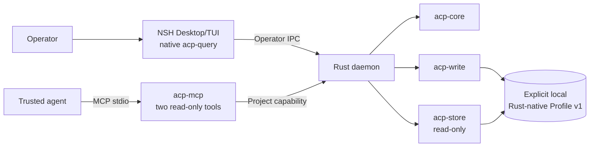

# Architecture and data ownership

The [product charter](product.md) defines purpose and authority. This document
describes the current Rust-native architecture and its durable target boundaries;
[interfaces](interfaces.md) defines wire-level behavior and
[security](security.md) defines the threat model.

## Topology

The daemon is the only production write owner. Clients exchange typed data and
requests with it; they do not open writable SQLite connections or duplicate domain
resolution.

## Components

| Component | Responsibility | Must not own |
| --- | --- | --- |
| `crates/acp-core` | Preference/Handoff resolution, typed context and conflict resolution, bounded repository document and fingerprint adapters | SQLite connections, UI, process execution, protocol transport or authorization grants |
| `crates/acp-store` | Explicit-path, strict read-only access to fresh Rust-native Profile v1 | Writes, schema migration or legacy compatibility |
| `crates/acp-ipc`, `acp-daemon` | Local transport, peer/capability checks, scoped reads, project state, leases and daemon-owned writes | TCP listener or caller-selected wider scope |
| `crates/acp-mcp` | Read-only stdio bridge to project-bound IPC | Profile or task mutation |
| `crates/acp-write` | Private Profile v1 creation and typed transactions with lease/epoch fencing, CAS and receipts | Direct UI/CLI access, arbitrary existing-path writers or generic SQL |
| `crates/acp-query` | Native operator reads and typed writes through authenticated daemon IPC | Direct database access or a second writer |
| `apps/core`, `apps/client`, `apps/ui` | Pure operator state/presentation; native IPC and Windows→WSL2 bridge; NSH Desktop/TUI surfaces | Direct database access, duplicate resolution logic or independent authority |

The root product crates and operator app are separate Cargo workspaces with separate
lockfiles. NSH dependencies do not enter the daemon's dependency closure. The Web
UI is an offline synthetic target without native IPC.

## Windows GUI → WSL2

The Windows-native Desktop can operate a daemon inside one explicitly selected WSL2
distribution. WSL owns Linux project paths, daemon and Profile/runtime state. The GUI starts one long-lived `acp-wsl-bridge` helper per
connection through `wsl.exe --exec`, without a shell, TCP, port forwarding or
mirrored networking.

The helper loads operator capabilities inside WSL and forwards only typed requests
to the same daemon authority used by local clients. Tokens never cross the stdio
boundary. It cannot validate or approve mutations, open SQLite or start agents. The framing, allowlists and uncertainty behavior are defined
in [interfaces](interfaces.md#windows-gui--wsl2-bridge).

The secondary WSLg Linux GUI/TUI path connects directly to the same WSL daemon over
Unix IPC and does not use the bridge. WSLg evidence is not standalone Linux support
evidence.

## Data ownership

| Data | Authority / source of truth | State and change path |
| --- | --- | --- |
| Personal preferences, including project-scoped choices | Human-reviewed user-local SQLite | Explicit operator action; never tracked Profile files |
| Project contracts | Repository-owned AGENTS/docs and reviewed engineering configuration | Bounded live reads; no automatic prose interpretation or file creation |
| Project registration | User-local Profile plus daemon-private project state | Operator-write `project.add` / `project.remove` after checking one chosen path |
| Suggestions and reviews | User-local SQLite proposal/review records | Approval binds exact content, revision and scope; repository changes still need repository review |
| Effective context | Derived from current sources and review state | Any cache requires source versions and invalidation; never outranks sources |
| Session constraints and Handoff | Historical local records | Frozen references/content versions describe history, not live policy or execution authority |
| Provenance/evidence | Minimal local records with reporter/observer/verifier attribution | No raw transcript or credential store; export requires explicit selection |

The daemon's private state contains the registered project set and optional startup
Profile choice. Registration is not permission to discover or share every project.
The daemon checks only the path chosen by the operator and refuses system, control,
foreign-owned or otherwise ineligible roots. GUI, bridge and agent clients never
scan directories.

## Profile and write ownership

Only fresh Rust-native Profile v1 (`PRAGMA user_version=1`) is accepted. It is not
compatible with the retired Python prototype's v1 or the historical synthetic v2.
There are no legacy readers, migrations, downgrades, import/repair paths or
runtime fallback.

Profile creation is explicit and never overwrites an existing file. Startup selects
a Profile only when the operator requested that exact path. Write enablement is
independent, bounded to the Profile/generation/owner epoch and never remembered
across daemon runs.

Only the daemon links and invokes `acp-write`. Operator read/control and write
capabilities are separate. Transactions use exact typed commands, expected
revisions or absence, immutable operation IDs, request digests, same-epoch receipts
and strict preference transitions. Disabling writes drains admitted work and
prevents new admission. An uncertain transport result may already have committed;
only an explicit identical retry can settle it.

During validation, coordinated wire-schema and Profile-schema breaking changes are
acceptable. Do not introduce dual-version support or migration layers.

## Repository contracts and context resolution

Repository contracts are current project sources, not personal Profile values. An
optional exact `ACP.contracts.md` source can provide bounded, versioned structured
claims. Existing allowlisted documents remain valid document sources. Ordinary
repository prose is not automatically parsed into enforceable contracts, and
onboarding never scaffolds, migrates or rewrites `AGENTS.md` or contract files.

The resolver binds one registered project, rechecks registration and reads live
Git/allowlisted metadata. A compatible project preference masks a global preference
for the same key; within one scope/key, the newest confirmed ID wins. Suggested,
rejected and deprecated records are excluded. Document bodies are explicit opt-in.

Typed resolution represents applicability, masking, conflicts and unknown inputs
explicitly. Caller-supplied selector labels affect applicability only; they never
grant authorization. Repository claims outrank personal confirmation. Missing or
malformed source data refuses or narrows affected output rather than widening it.
Private resolution explanations are not exposed wholesale to agents.

Handoff lookup is exact project/task and compares current HEAD, branch, worktree and
bounded content fingerprint with historical state. Missing observations remain
unknown. Historical validation JSON and source labels do not constitute fresh
verification or a complete provenance engine.

## Trust

MCP is project-bound and read-only. Local IPC separates operator, operator-write
and project-bound agent capabilities; OS user identity alone does not grant an
operator role. Unix sockets and Windows named pipes remain local, without a browser
gateway.

Agent-reported actions, daemon observations and independent verification are
separate claims. Checksums detect specified content differences, not reporter
identity or event truth. Same-user filesystem access bypasses cooperative protocol
boundaries; see [security](security.md).
