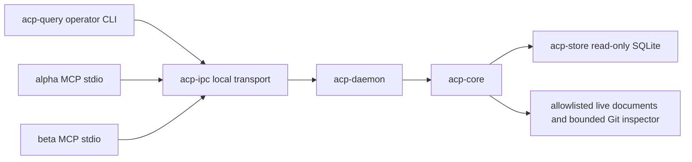

# P1-D: runnable local read-only Rust service

Issue #12, based on main `1f024fb8b2d11ba0da24934eff5681ab0fe6d1a9`.
Python `acpctl`/MCP are unchanged and remain the reference/fallback and only profile
write interface. Cloud/tests use disposable synthetic fixtures exclusively.
A local operator may explicitly opt in to **read-only** access by supplying an
existing database path. Nothing discovers AGENT_CP_HOME/XDG/LOCALAPPDATA profiles.
There is no migration, daemonization, automatic startup, GUI or external agent launch.



## Build and synthetic operator demo

Prerequisites: pinned Rust 1.99.1, native C compiler for bundled SQLite, Python
3.11+ and Git. No API key or package outside the Cargo lockfile is required.
From the checkout, build once:

```bash
cargo build --workspace --bins --examples --locked
```

Linux/macOS, terminal 1 (DEMO must be outside the checkout; use a short socket path):

```bash
DEMO=$(mktemp -d /tmp/acpd-demo.XXXXXX)
export DEMO
PYTHONPATH=src python tools/sqlite_fixture.py "$DEMO/fixture"
./target/debug/acp-daemon --database "$DEMO/fixture/state/context.sqlite3" \
  --runtime-dir "$DEMO/run" --endpoint "$DEMO/run/control.sock" \
  --allow-project alpha --allow-project beta
```

The daemon creates run with private permissions; do not precreate it with 0755.
Keep this foreground process running. In terminal 2, set DEMO to the same temporary
path (a path is not a token), then query:

```bash
./target/debug/acp-query --runtime-dir "$DEMO/run" --endpoint "$DEMO/run/control.sock" health
./target/debug/acp-query --runtime-dir "$DEMO/run" --endpoint "$DEMO/run/control.sock" projects
./target/debug/acp-query --runtime-dir "$DEMO/run" --endpoint "$DEMO/run/control.sock" context alpha --include-documents
./target/debug/acp-query --runtime-dir "$DEMO/run" --endpoint "$DEMO/run/control.sock" handoff alpha shared
```

Windows PowerShell, terminal 1:

```powershell
$demo = Join-Path $env:TEMP ("acpd-demo-" + [guid]::NewGuid().ToString("N"))
$env:PYTHONPATH = "src"
python tools/sqlite_fixture.py (Join-Path $demo "fixture")
.\target\debug\acp-daemon.exe --database (Join-Path $demo "fixture\state\context.sqlite3") `
  --runtime-dir (Join-Path $demo "run") --endpoint demo `
  --allow-project alpha --allow-project beta
```

Windows endpoint is a validated bare pipe label. Internally it becomes a per-user
SID-hash-prefixed kernel pipe name; no TCP is used. Terminal 2 uses the same $demo:

```powershell
.\target\debug\acp-query.exe --runtime-dir (Join-Path $demo "run") --endpoint demo health
.\target\debug\acp-query.exe --runtime-dir (Join-Path $demo "run") --endpoint demo context alpha --include-documents
.\target\debug\acp-query.exe --runtime-dir (Join-Path $demo "run") --endpoint demo handoff alpha shared
```

For an MCP stdio client, use `target/debug/acp-mcp` (Windows: `.exe`) with args:

```text
--runtime-dir <DEMO/run> --endpoint <Unix absolute socket path or Windows bare label>
--project alpha --capability-file <DEMO/run/agent-alpha.cap>
```

The client configuration contains only file paths, never file contents. `operator.cap`
is for the trusted operator CLI, and is rejected by the bridge. Test the bridge
with a legacy initialize + notifications/initialized or stateless 2026 metadata;
stdout contains JSON-RPC only. An external harness's configuration format is its
own; no claim is made that Codex/Kimi was installed or started in Cloud.

The entire synthetic demo/negative suite is reproducible in one command after build:

```bash
PYTHONPATH=src python tools/test_local_service.py -v
```

Stop the foreground daemon with Ctrl-C (Unix SIGTERM is also handled; Windows
CTRL_BREAK is handled when the host delivers console signals). Clients/GUI exit
do not stop it. Remove the synthetic DEMO directory only after all processes stop.
There is deliberately no IPC shutdown/mutation method or automatic service install.

## Protocol and capabilities

Transport is a four-byte unsigned big-endian byte length followed by one UTF-8
JSON object, max 1 MiB including responses. Each connection first authenticates:
`{api_version:1, credential:<32-byte capability array>}` (never log/send it on a
command line). The daemon replies with version/readiness/derived access, not a token.
No caller-supplied role/project is accepted in this handshake. OS same-user identity
and possession of a valid capability are both required.

Requests have exactly api_version, id (nonempty string <=64 bytes), method, params.
Duplicate IDs on a connection, extra DTO/parameter fields, wrong versions/types,
malformed/truncated/oversized frames fail with sanitized categories. Responses have
api_version, nullable id, result and error, with exactly one result/error active.

| Method | Operator params | Project-bound agent params |
| --- | --- | --- |
| daemon.health | `{}` | `{}` |
| project.list | `{}` | Denied |
| context.get | `{project, include_documents?:bool}` | `{include_documents?:bool}` |
| handoff.get | `{project, task_id}` | `{task_id}` |

The daemon enforces its launch allowlist and the capability binding server-side.
Even an operator cannot select an existing but non-allowlisted project. An agent
cannot add project/project_id, request listing, claim operator authority or invoke
writes. The bridge never forwards a project from an MCP message. Launch labels
are restricted to 1–64 ASCII alphanumeric/underscore/dash/dot characters (not . or
..); this is a Rust runtime-label limitation, not a Python CLI behavior change.

Errors are enum categories: InvalidRequest, Version, Unauthorized, Unsupported,
NotFound, Unavailable, TooLarge, Timeout, Busy, UnsafeRuntime, EndpointCollision.
Rejected framing/auth may close the connection; excess peers are closed without
queueing. Error logs do not contain raw SQL, docs, preference values, tokens or paths.
Operator output is machine-readable JSON, exit 0 on success / 3 on query failure;
invalid invocation/daemon startup errors exit 2. Health exposes schema/version and
readiness only, without project docs/values/absolute paths. No bridge has a DB path.

Limits: 16 admitted peers, one sequential request per connection, 32 requests and
remembered IDs per connection, 2 seconds for the **whole** input/output frame and
handshake, 5 seconds for service computation, 7 seconds for a client response.
Parser recursion is bounded by serde_json. The blocking pool has 16 workers; a
compute timeout closes the peer and retains its slot until the job actually ends,
so timed-out jobs cannot create an unbounded queue. Responses larger than 1 MiB
fail rather than being truncated into misleading data. SQLite uses its existing
busy timeout. These limits do not promise hard realtime bounds on a pathological
trusted database, remote filesystem or stalled OS I/O.

## OS and storage security

Unix: private operator-owned 0700 directory, 0600 socket/credentials/lease, O_NOFOLLOW
for credential/lease opening, regular-file owner/link checks and peer UID checks in
both directions (SO_PEERCRED/getpeereid via Tokio). Stale socket cleanup is allowed
only with the exclusive OS lease, correct socket type/owner/mode and a refused
connect probe; live endpoints and regular files are never removed. Cleanup checks
the created socket inode. A hard kill leaves a stale endpoint that can be safely
restarted; credentials rotate, and old bridge processes must restart.

Windows: CreateDirectory/CreateFile security descriptors explicitly assign current
user ownership and protected current-user-only DACLs. Runtime/credential owner and
ACE contents are inspected; broad ACLs/reparse points fail. Named pipes have the
same explicit user-only DACL, first-instance collision protection and remote-client
rejection. Peer PID -> process token SID is checked in both directions; inability
to query identity fails closed. This is not a peer-impenetrable sandbox or a
privilege broker. Client security QoS uses identification level, not impersonation.

Credentials are private per-launch/per-project capabilities, not per-invocation
secrets. Paths, not tokens, select them. Runtime directories must be outside project
checkouts. Managed OS temp-mount Git metadata is not treated as a project checkout;
actual nested checkouts and the build checkout remain rejected. Partial credential
publication is refused, not silently overwritten. Normal shutdown removes only
this launch's credentials; hard-kill restart rotates recognized private files.

Same-user programs that can read files directly can read credentials/SQLite too;
root/admin, malicious same-user races and credential theft are outside this scope.
Real cross-account denial/privilege attacks are NOT_RUN unless explicitly evidenced.
Windows hardlink attacks and remote/network filesystem behavior are NOT_RUN. Tests
use no actual profile DB or AGENT_CP_HOME, and no capability content is committed.

## Git, MCP parity and explicit differences

Git uses bounded shell-free subprocesses, strips inherited GIT_* selectors, disables
fsmonitor and optional index writes, validates the repository root and reports
HEAD/branch/dirty/count best-effort. Missing Git/unregistered Git roots/unavailable
commands return unknown fields, never a fabricated clean tree. Only the existing
five allowlisted documents are read, at most 16 KiB each, with explicit content opt-in.

Rust does **not** implement Python's acp-worktree-v1 fingerprint. Current handoff
fingerprint is null and existing core stale/incomplete-evidence warnings apply.
A real committed Git fixture separately verifies the fingerprint delta; it is not
called hash parity. Context/handoff values, source/status/IDs and opaque evidence
otherwise come from the same read-only adapter. Existing v0 legacy/fingerprinted
and v1 schema support is retained, with no creation/migration.

The bridge preserves the P0 two-tool schemas, legacy initialize/notification state,
stateless 2026 _meta, ping, tools/list and tools/call behavior. A real subprocess
suite compares 132 normalized JSON-RPC responses against Python across all three
schemas and six bridge processes. Text-wrapped JSON is parsed for equality; IDs,
timestamps and evidence are not dropped. Unknown Git HEAD fixtures make exact
fingerprint-unavailable equality meaningful. A separate live-Git test records the
known fingerprint difference. Legacy missing fingerprint is mapped to logical NULL
by the existing read-only Python oracle, without running its schema-writing constructor.

Resource bounds, strict RFC JSON (no NaN), 64-bit numeric JSON-RPC IDs and sanitized
non-string unknown tool labels are limits beyond the Python prototype. The bridge
is a tested subset, not full MCP conformance/certification. External harness versions,
GUI/device accessibility, ACP/PTY sessions and production operational hardening
remain NOT_RUN. [ADR-0002](../adr/0002-local-ipc-capabilities.md) records the tradeoffs.

## Validation and support evidence

Local environment: Linux x86_64, Python 3.12.14, Rust/Cargo 1.99.1. Baseline before
changes passed 28 Rust / 21 Python tests. Local E2E currently passes 8 tests, including
real foreground daemon + CLI + two MCPs, exact protocol parity, direct IPC attacks,
allowlist denial, frame limits/duplicates/timeouts, bounded concurrency/backpressure,
client cancellation, stale endpoint/restart/credential rotation, unchanged DB bytes,
WAL-visible updates, live/unknown Git, signal cleanup and insecure runtime refusal.
The Windows IPC/client/bridge cross-target lint check also passes locally; that
is compilation evidence only, not Windows runtime evidence.

A separate local-service CI matrix actually runs these processes on Linux/macOS/
Windows. Ordinary unit tests, Python regression, C2A and C2B1 process-kill matrices
continue to run separately. Actual final SHA, run links, outcome counts and any
Windows signal-delivery NOT_RUN reason are recorded in the Draft PR.

| Capability | Local Cloud | Required remote evidence |
| --- | --- | --- |
| Unix socket + UID + capability isolation | Linux E2E PASS | Linux/macOS E2E |
| Named pipe + current-user DACL/SID | Cross-compile only | Windows real process E2E |
| Graceful Unix signals | Linux PASS | macOS CI |
| Windows console CTRL_BREAK | NOT_RUN locally | Executes when host can deliver; explicit NOT_RUN otherwise |
| Other OS user/privileged attacks | NOT_RUN | Separate accounts/security review |
| Rust/Python fingerprint hash equality | NOT_VERIFIED | Algorithm not implemented; null + warning is intentional |

Troubleshooting: reject broad runtime permissions/ACLs rather than relaxing them;
use a short private Unix socket path; stop an existing daemon before rebinding;
inspect a stale pending credential file manually while stopped. If the daemon
restarts, reconnect/restart bridges to load new capabilities. If health fails on a
future/incompatible DB schema, use the unchanged Python fallback and investigate;
never run a migration merely to make this service start. No automatic fallback
opens a network socket. Subsequent production rollout should add reviewed install/
recovery procedures, cross-account OS tests and fingerprint conformance separately.
