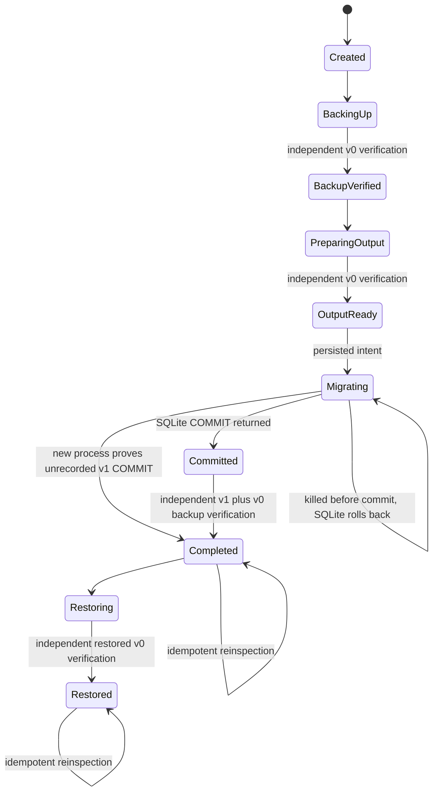

# P1-C2B1: persistent synthetic manifests and real process recovery

Issue #10; base main `c93279465672888cd04a91926f836a88f378f6e1`.
No real profile/database access or production migration is authorized here.
Python CLI/MCP and `acp-store` source/public read-only opening behavior are unchanged.

## Separate test-only authority

The existing C2A `SyntheticWorkspace` still owns a TempDir and RefCell provenance.
Dropping it deletes its artifacts; reopening SQLite connections was not process
recovery. This implementation preserves that API and adds a **separate** protocol
behind the nondefault `acp-rehearsal/recovery-tests` feature. Its binary is named
`acp-recovery-test-worker`, requires `--synthetic-only`, accepts no path arguments,
and receives a bounded request/capability only over its parent's stdin pipe.

Only `TestRoot::new` creates the fresh temporary root and invokes the repository's
synthetic Python builder. The parent retains the TempDir across child death;
no child destructor owns/deletes the root. The parent creates a random session
identity, random 256-bit HMAC key and source fingerprints after controlled WAL
setup. The key stays in parent/worker memory and the private input pipe, never in
a manifest, argv, environment, Git or logs. No profile state directory is discovered.
A new worker receives the same parent-held capability, with **fresh memory**.

Manifest MACs are bound to the canonical root, session, original source bytes,
original v0 shape and logical records. The parent is trusted: ancestry and a
manifest cannot prove data origin, and a party able to launch this test binary
with a fabricated key/authority is not cryptographically authenticated as the
original test parent. Same-user memory access/key theft and deliberately importing
real data into a synthetic root are outside this testing contract. This is not
an OS sandbox or production consent flow. The feature gate, no-adoption parent
constructor, fixed roles and path checks prevent accidental general-profile use;
they do not supply hostile same-user isolation.

Root inventory is narrow: builder-created fixture paths, four fixed DB roles,
known SQLite sidecars, immutable manifest generations and session.lock. Unexpected
files, traversal, symlinks/reparse points and Unix hardlinks fail before DB work.
Unix root/control/DB modes are checked as 0700/0600. Windows checks read-only file
attributes and rejects reparse points, relying on inherited temporary-root ACLs;
Windows hardlink defense and cross-account ACL attacks are NOT_RUN. An OS file
lease serializes cooperating workers and is released on process death. Output
SQLite writer locks independently protect the transaction. A lease file is not
an authorization token and is never used to locate user data.

## Manifest and flush policy

Each `manifest.NNNNNNNN.json` is an immutable, HMAC-SHA256 authenticated generation
with a SHA-256 link to its predecessor. It contains format version, random session
ID, exact **relative** role names, expected source v0 shape/output v1, opaque
source/logical/backup/restore hashes, sequence, previous/desired/current stage,
last independently verified stage and an error/reconciliation classification.
It contains no actual host/profile path, key, raw SQL, preference values, timestamps
from records or nested evidence. Logical hashing uses typed, length-delimited
records in deterministic table/row order, including all registry/preferences/
handoffs and sqlite_sequence; a legacy absent fingerprint normalizes to NULL.

Publication exclusively creates a private manifest.pending, writes bounded JSON,
flushes via sync_all, closes it, and renames it to a **new** generation (never
replacing an old manifest). Unix additionally syncs the directory and refuses
unsupported/failing directory sync. On Windows only file flush plus same-directory
rename is claimed; `directory_synced=false` explicitly records this portable API
limit. SQLite writers use synchronous=FULL. These successful API calls and kill
tests do **not** prove hardware power-loss durability or Windows directory flush.

A leftover pending file is an ambiguous publication: recovery refuses instead of
deleting it or falling back silently. Missing/truncated/modified/foreign manifests,
sequence gaps and invalid MACs refuse before opening databases. A valid older
prefix can be replayed by deleting its tail; there is no external monotonic counter.
DB reconciliation still prevents reset/overwrite: an old Created record with
existing backup/output refuses, while a valid Migrating prefix can accept a
separately proven committed v1. Authentication protects metadata integrity for a
trusted parent; the manifest is never proof that SQLite committed or user consent.

## State diagram



`Committed` is an observation of COMMIT returning, not independent recovery
verification. Until Completed, `verified_stage` remains the last proven output
state. Interrupted recovery transitions record ReconciledFromDisk. Refusals
that cannot trust/publish metadata return only a sanitized error class; they do
not rewrite an untrusted manifest to log the failure.

## Recovery decisions

Every new worker verifies authority/inventory, original source, backup integrity,
exact schema, all logical records and any previously authenticated physical hash.
Sources are read-only. Backups/restores are frozen with DELETE journaling and
independently reopened as single-file artifacts (unexpected backup/restore sidecars refuse); source WAL is never copied as
an ordinary main-file copy. Output recovery opens only the authorized output
read-write so SQLite can replay/roll back its own hot journal before inspection.
No existing candidate is overwritten or removed by the restart protocol.

| Persisted/observed condition | Decision |
| --- | --- |
| Created, no backup/output | Persist backup intent and create a new Backup API snapshot |
| BackingUp, no candidate | Create new backup |
| BackingUp, complete but unrecorded v0 candidate | Reinspect exact original shape/records, authenticate its hash and proceed |
| Incomplete/changed/corrupt backup | Refuse; preserve candidate, no output migration |
| BackupVerified, output absent | Persist output intent, create a new output copy |
| PreparingOutput, valid original v0 output | Reinspect and promote OutputReady |
| Partial output or output collision without matching intent | Refuse; preserve files |
| Migrating, original v0 after crash | SQLite rollback, revalidate under BEGIN IMMEDIATE, retry transaction |
| Migrating, v1 after unrecorded commit | Prove v1 plus unchanged v0 backup, then mark Completed |
| Committed/Completed but SQL says v0 | Refuse ambiguity; no implicit remigration |
| Completed v1 | Reinspect source/backup/output and return idempotently |
| Restoring, valid unrecorded restored v0 | Reinspect original shape/records and mark Restored |
| Partial restore | Refuse; no overwrite/reset |
| Missing required backup, unknown versions, partial v0 schema, evidence drift | Refuse |
| Pending/truncated/tampered/foreign/missing manifest | Refuse; no DB writes |
| Cooperating worker lease or SQLite writer held elsewhere | Locked; retry after owner termination/release |

Backup API reads a pinned source snapshot, includes committed WAL data and excludes
uncommitted changes. The source main-file hash and logical snapshot are bound to
the capability. A later source checkpoint/write can invalidate that expectation;
recovery refuses rather than silently resealing changed data. Main source bytes
remain unchanged during the measured worker operations. This does not promise
unchanged atime, SHM bytes or absence of SQLite-created bookkeeping sidecars.

## Real process evidence and test target

```bash
cargo fmt --all -- --check
cargo clippy --workspace --all-targets --locked -- -D warnings
cargo test --workspace --all-targets --locked
cargo build --locked --example contract_reader
cargo build --locked -p acp-store --example sqlite_reader
PYTHONPATH=src python tools/check_p1_parity.py
PYTHONPATH=src python tools/check_sqlite_parity.py
PYTHONPATH=src python -m unittest discover -s tests -v
cargo run --locked -p acp-rehearsal --example synthetic_rehearsal -- --synthetic-only
# Separate feature-gated target; ordinary unit tests are not a substitute:
cargo clippy --workspace --all-targets --all-features --locked -- -D warnings
cargo test --locked -p acp-rehearsal --features recovery-tests --test process_recovery -- --nocapture
```

Local Linux x86_64, Python 3.12.14, Rust/Cargo 1.99.1. Baseline passed 28 Rust and
21 Python tests. Final local validation passes the same ordinary tests, 120 JSON
+78 SQLite comparisons, both C2A guarded flows, and **11 process tests**, 0 failed
or ignored. Ten process tests are shared; one Unix permissions/hardlink test is
replaced by a Windows reparse/read-only-attribute test on Windows. They do not
pretend a compile-disabled platform test ran locally.

The main process test executes **36** combinations: two original shapes × two
output modes (WAL/DELETE) × these nine checkpoints: before_backup,
backup_verified_before_manifest, backup_verified, before_transaction, after_ddl,
before_commit, after_commit, commit_recorded, complete. At each READY message the
parent genuinely calls Child.kill, waits/reaps, checks SIGKILL on Unix (Windows
uses TerminateProcess), spawns a different child and compares source/backup/output
states. It then starts yet another worker to verify idempotence. Four more named
copy/restore boundaries are backup_copy, output_copy, restore_copy and
restore_verified. manifest_flushed covers kill after file flush before rename.

Additional cases cover a live WAL writer, committed/uncommitted visibility,
separate-process SQLite writer contention, process lease release on death,
missing/corrupt/changed backups, unknown/partially mutated schemas, collisions,
manifest truncation/tamper/foreign session/gaps/prefix replay, partial manifest
write, unexpected files, reparse/hardlink checks and explicit permission policy.
Refusals assert existing DB bytes unchanged; successful recovery compares typed
preferences/handoffs and full raw logical hashes. A separate read-only Python
oracle compares **all** project/preference/handoff/sequence metadata and opaque
JSON from source, backup, v1 output and restored v0 after a real kill/new process.
No record values, manifest contents or capability bytes are printed.

A 25-second receive deadline and RAII guard kill/reap workers on parent failures;
workers have a 45-second watchdog. The independent process-recovery CI job has a
15-minute limit and runs on Linux/macOS/Windows with fail-fast disabled. Exact SHA,
remote job conclusions and available evidence are recorded in the Draft PR.

During local harness development, one contention assertion failed because parent
filesystem reads could release its own POSIX fcntl locks. Moving the lock-holding
writer to a separate child corrected the test; the final run uses real cross-process
contention and does not rely on same-process lock assumptions.

## NOT_RUN and production gate

Not tested: sudden power loss, hardware write-cache durability, OS disk-full/I/O
faults, privileged ACL attacks, Windows directory sync/hardlinks, network filesystems,
malicious same-user races/key theft, parent-runner termination or loss of its
capability. The tested parent stays alive: if its capability is lost, the test
session cannot be adopted/recovered by a new authority. Partial-manifest failure
is deterministic software injection; file permission rejection is an explicit
policy test, not a claim of root-proof OS access denial. Process kill resilience
must not be described as proof of any of these untested conditions.

P1-C2B2 needs separate authorization and a reviewed end-to-end consent flow for
exact profile and verified backup locations, backup retention/permissions, writer
quiescence and ownership, stale-lock recovery, durable recovery authority/manifests,
validated platform flush policy and version-aware rollback. Rehearse power-loss/
disk-full/parent-loss behavior before a staged opt-in rollout. V1 and a manifest
confer no permission to access personal data or switch writes away from Python.

### CI-driven portability corrections

The first remote process matrix exposed a collision-fixture permission assumption:
Unix CI umask 022 created 0644, so the private-file policy correctly refused with
Permissions before reaching Collision. The collision fixture now explicitly sets
0600; a local umask-022 run verifies the intended collision branch. Windows Clippy
also rejected set_readonly(false) in fixture cleanup; it now restores the saved
original permissions object. No policy or lint was disabled. A bounded CI wrapper
retains Cargo's exact status/output while exposing sanitized failure headlines as
check annotations, allowing diagnosis when log-archive egress is unavailable.
Final remote outcomes and exact corrected SHA are recorded in the Draft PR.
