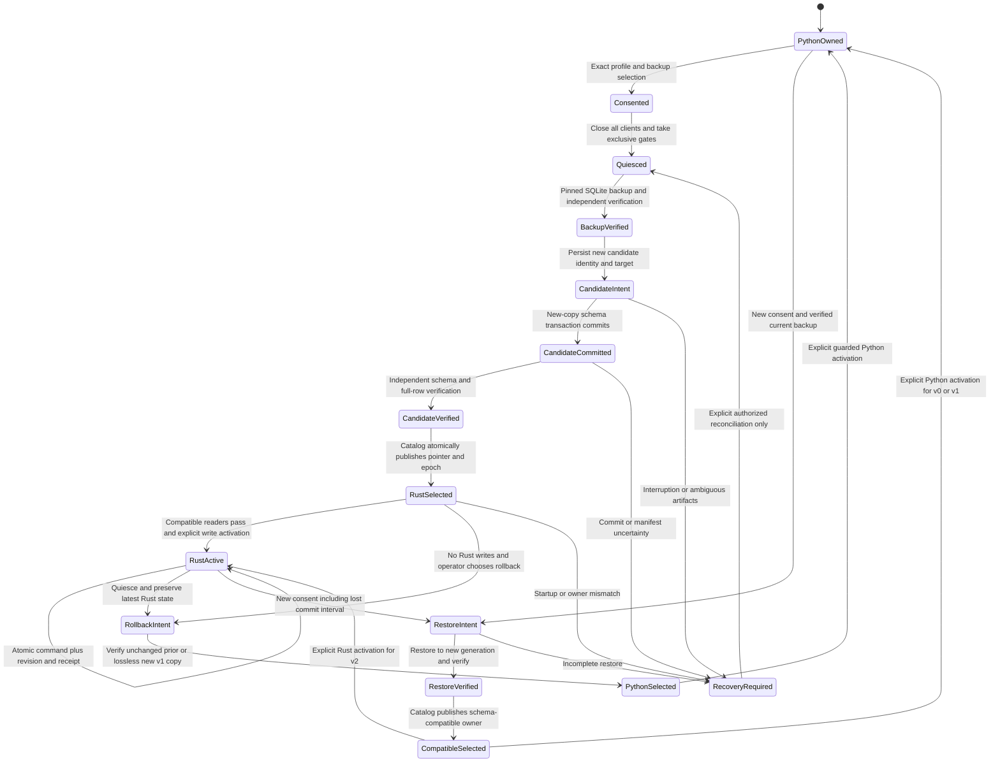

# P1-M0 storage ownership and acceptance plan

> **Historical design record — execution plan superseded by [ADR-0006](../adr/0006-rust-only-runtime.md).** This document preserves the original M0 analysis, M1 contract and historical evidence only. Its Python read-only adapter, Python rollback owner, legacy-schema compatibility, compatibility-release, schema downgrade, and multi-generation cutover steps are no longer current requirements. The product target is a fresh Rust-native Profile v1; it is not compatible with the old Python v1 or M1 synthetic v2. Neither format is migrated or preserved. Follow [ADR-0006](../adr/0006-rust-only-runtime.md) and [Issue #40](https://github.com/ybakiame/agent-control-plane/issues/40) for current work.

Design-only companion to [Accepted ADR-0005](../adr/0005-local-storage-and-write-ownership.md).
The owner accepted ADR-0005 on 2026-11-12 after PR #37 merged; this did not
approve a real-profile operation or production writer.
Authority: [Issue #36](https://github.com/ybakiame/agent-control-plane/issues/36).
Reviewed M0 source baseline: main `2a5949120aacd0523cd7fa5e417548e1e648bc81`.
M1 is now complete as a synthetic-only implementation in [PR #39](https://github.com/ybakiame/agent-control-plane/pull/39),
merged at `3083c407d02c34bbbfef402f7ae57bb7eda248d1`. M2 is active in
[Issue #40](https://github.com/ybakiame/agent-control-plane/issues/40). The remaining
M2–M5 mechanisms below are **NOT_IMPLEMENTED / NOT_RUN** unless explicitly identified
as historical C2A/C2B1 or merged M1 evidence. M0 itself selected/accessed no profile;
M1/M2 are restricted to disposable synthetic profiles.

## Source review and ownership matrix

Source review includes [AGENTS](../../AGENTS.md), [product](../product.md),
[architecture](../architecture.md), [interfaces](../interfaces.md),
[security](../security.md), [roadmap](../roadmap.md),
[Accepted ADR-0004](../adr/0004-product-domain-trust.md), and the
[P1-L typed contract](typed-context-v1.md). The implementation anchors below explain
why a compatibility/fencing release must precede cutover.

| Component / data | Implemented now | Proposed owner / restriction |
| --- | --- | --- |
| [Python Store](../../src/agent_control_plane/store.py) | Constructor opens RW, enables WAL, creates schema and may add fingerprint; owns all P0 mutations; no version check; allows suggested→deprecated | Legacy behavior may remain during explicitly Python-owned phase; M2 fencing/strict compatibility required before cutover; current direct path unsafe afterward |
| [Python CLI](../../src/agent_control_plane/cli.py) | Uses Store for reads, writes and MCP | Thin authenticated frontend; reads avoid Store; no fallback writer |
| [Python MCP](../../src/agent_control_plane/mcp.py) | Two read tools, but launched by CLI with initialized Store | Genuinely RO adapter or read IPC; no initialization writes, operator credentials or mutations |
| [acp-store](../../crates/acp-store/src/lib.rs) | Explicit existing-path RO connection; structural/version inspection before reads | Remains RO; add reviewed v2 reader support before activation |
| [daemon](../../crates/acp-daemon/src/main.rs) | Uses SqliteStore; operator sessions and project/lease-scoped reads, no profile mutation | Sole ordinary writer only when explicitly opted in; separate authenticated write extension/library |
| [acp-query](../../crates/acp-query/src/main.rs) / NSH | Operator reads/session control; UI has no direct DB | Typed operator client of same daemon; no direct SQL or second writer |
| Proposed maintenance owner | Absent | Exclusive offline mode for backup/migration/restore; no ordinary mutation service |
| [acp-rehearsal](../../crates/acp-rehearsal/src/lib.rs) | Owned disposable synthetic roots; cannot adopt profiles | Remains synthetic-only; production machinery separate |
| Profiles, registration, preferences, Handoff | User-local SQLite; legacy source/validation fields | Same authority; exact legacy preservation; later generalized models separately reviewed |
| Contract sources / cache | Repository AGENTS/docs/accepted ADRs; bounded live reads | Repository remains authority; any DB index disposable and version-bound; no new cache/parser now |
| Proposed control catalog | Absent | User-local SQLite, separate catalog format; opaque identities/relative artifact roles/owner epoch/stage only |
| Session credentials | Private runtime files and daemon memory | Stay ephemeral and outside profile/backup/manifest; session grants never become write authority |

## Reader and writer compatibility

“Current Python” includes its initializing constructor; it is not a genuine RO
reader. A compatible replacement must use read-only SQLite open and fail closed
on unsupported version/shape **before any write-capable initialization**.

| Profile shape | Current Python Store | Current Rust reader/daemon | Proposed RO Python/Rust readers | Proposed ordinary writer |
| --- | --- | --- | --- | --- |
| v0 legacy, no fingerprint | Opens RW and adds nullable fingerprint; not side-effect-free | Reads with unknown fingerprint | Read without initialization/DDL | Guarded Python only before cutover; Rust refuses without explicit migration |
| v0 fingerprinted | Opens RW / initializes | Reads | Reads | Same pre-cutover restriction |
| v1 fingerprinted | Actual constructor/writes compatible in historical C2A | Reads | Reads | Guarded Python owner; Rust ordinary writer requires active v2 |
| v1 without fingerprint or malformed supported version | Constructor may repair; must not be used as validator | Refuses | Refuse without repair | Refuse |
| Proposed exact v2 | Version-blind: may initialize/write; **unsafe, never launch** | UnsupportedVersion | Reads after separately implemented exact-schema upgrade | Opted-in Rust daemon only, matching active generation/epoch |
| Unknown future version / unexpected schema | No version fence: **unsafe** | Refuses | Refuse | Refuse |

v0→v1 remains the already-implemented synthetic migration. M1 freezes the exact
v2 metadata DDL and validates new-copy synthetic v0/v1→v2 migration. The independent
control-catalog DDL/interface is documented only; no usable catalog, active-generation
pointer or cutover implementation exists. No real DB upgrade, runtime v2 reader
adoption or authenticated write extension exists today.

All clients on the profile must upgrade before a v2 cutover; “old reader supports
v1” is not permission to leave it on a retired path. Python compatibility reads
remain supported after cutover with the new RO adapter/read IPC. Old binaries are
retired, not retroactively made safe by `user_version`, ACLs or cooperative locks.

### Preference transition contract and compatibility gates

The [owner's review](https://github.com/ybakiame/agent-control-plane/pull/37#pullrequestreview-5867130588)
resolved the decision on 2026-11-12: new Rust writes follow Accepted ADR-0004 and
reject `suggested → deprecated`. This is a chosen future contract, not current
Python behavior; the ADR was separately accepted after the M0 PR merged. No new
Withdraw state/synonym is added.

The table applies to a **fresh** operation ID after authorization, owner/revision
checks and reading the current row within the writer transaction. Repeating an
already committed identical operation ID returns its receipt without reapplying
the transition. A fresh same-state request is not that retry.

| Current persisted state | ConfirmPreference | RejectPreference | DeprecatePreference |
| --- | --- | --- | --- |
| suggested | confirmed | rejected | InvalidTransition |
| confirmed | InvalidTransition | InvalidTransition | deprecated |
| rejected | InvalidTransition | InvalidTransition | InvalidTransition |
| deprecated | InvalidTransition | InvalidTransition | InvalidTransition |

`SuggestPreference` creates a new suggested row; clients cannot choose confirmed
as its initial status. `DeletePreference` remains a separate explicit operator
command with scope/revision checks, not a transition to a new state. Confirming a
suggestion still atomically deprecates existing confirmed same-scope/key peers.
Neither a model nor a receipt can confirm anything: explicit operator approval
of the exact record/revision is required.

The intentional CLI compatibility difference is that a fresh
`preference deprecate <suggested-id>` will fail under the future Rust owner (and
guarded compatibility owner), while current Python accepts it. It must not be
translated to reject/delete or silently sent to Python. Current Python may remain
unchanged in its explicitly Python-owned phase. Before Rust cutover M2 must fence
or retire all version-blind/direct-write launch paths; post-cutover frontend and
rollback-owner behavior must enforce the strict contract without fallback.

Migration is not a replay of historical commands: both v0 shapes and v1 may contain
deprecated rows with unknown transition history. Preserve those rows' IDs, scopes,
status, timestamps, source and unknown provenance, plus all Handoff/opaque validation
JSON bytes, through v0/v1→v2. Do not reinterpret, repair or retroactively reject
them. Schema/page bytes may change; legacy logical fields and opaque payload bytes
may not, except the already specified absent-fingerprint→NULL mapping.

| Synthetic gate / current status | Required assertion |
| --- | --- |
| M1 positive transitions — PASS in merged PR #39 | suggested→confirmed, suggested→rejected and confirmed→deprecated succeed; confirmation's peer deprecation is atomic; suggestion cannot start confirmed |
| M1 transition negatives — PASS in merged PR #39 | Fresh suggested→deprecated and every other InvalidTransition cell refuse; compare full logical DB state, technical revisions, commit sequence and receipts before/after; all unchanged |
| M1 current-state race / retry — PASS in merged PR #39 | Competing commands recheck pre-command state and expected revision inside the transaction; a stale request cannot act on a formerly suggested row; lost-response same-ID retry returns only its original receipt |
| M1 migration history preservation — PASS in merged PR #39 | Both v0 shapes and v1 contain synthetic historical deprecated rows, including permissive-edge examples; after v2 migration every original ID/status/timestamp/scope/source/unknown provenance and opaque JSON byte is preserved |
| M2 CLI and fencing compatibility — NOT_RUN; Issue #40 | Exercise documented deprecate-on-suggested difference through future frontend/owner paths, positive flows and denied logical-state/revision invariance; legacy Python phase remains clearly distinguished; direct/version-blind paths fenced/retired before cutover and never used as fallback |
| M2 guarded compatibility and rollback-owner reads/writes — NOT_RUN; Issue #40 | Historical deprecated rows remain readable and excluded from agent context; guarded Python rollback owner also rejects new suggested→deprecated; native Windows and Linux/WSL compatibility tests preserve existing IPC/MCP/lease boundaries |

Initial v2 command receipts/revisions are concurrency/commit bookkeeping, not
ADR-0004's complete human `ReviewDecision` or verified operator attribution. Role
labels/digests are not independent identity/evidence. Operator confirmation remains
explicit; full rationale/time/attributed-actor decision history belongs to P1-O
unless separately accepted. None of these gates is implemented or run by M0.

## Coordination and durable stage model

The following is the proposed **future** protocol, not C2B1's implemented JSON
test manifest. Use a private versioned SQLite control catalog: immutable stage
rows plus a transactional active-generation/owner pointer. Catalog and profile
commits are distinct; every transition validates both before proceeding.

Each stage binds operation/profile identity, fixed relative roles, source and
target schema, generation/owner epoch, previous/desired/verified state, backup
verification digest, commit watermark and sanitized outcome. Absolute location
selection stays in the private local operator interaction, not stage/log exports.
These are operational manifests in SQLite, not a signature or evidence chain.
No metadata contains preference/Handoff/evidence bodies or credentials.

The stable coordination lock has two roles: a shared profile gate for all open
connections, exclusive maintenance gate for cutover/restore, plus a separate
exclusive writer lease. Lock acquisition order is profile gate → writer lease →
catalog transaction → profile transaction; do not hold transactions across an
inverse acquisition. Drain/close shared holders before acquiring the exclusive
gate. Maintenance prevents new admission; all timeouts fail boundedly, without
force-unlocking. Catalog publication and profile transactions never overlap as an
assumed atomic two-DB commit. A fresh process locks first, then reconciles.
The control root/lock namespace is fixed to the canonical profile identity; passing
another control directory cannot create a second owner. Managed generations have
fixed relative roles. For original/backup files outside that root, recovery needs
operator reselection and identity verification, not an absolute-path manifest or
automatic search. Missing reselection is a safe blocked outcome.

`Consented` is permission for that selected operation, not persistent write
activation. `RustSelected` records selection while admission remains closed;
it is not a running writer. Fresh daemon restart revalidates prior explicit
enablement and generation; an incomplete maintenance operation never auto-resumes.
If reader checks fail, keep write admission closed and offer explicit rollback.
Maintenance stops managed sessions/revokes context leases through existing controls;
resumption requires fresh context binding, not cached pre-cutover authority.

### Failure and recovery decisions

| Boundary / failure | Required future decision | Retained state / visible outcome |
| --- | --- | --- |
| Held lock, long-lived MCP reader, unknown old process | Close admission, bound wait, refuse; no kill or force-unlock | Original owner/generation unchanged; Busy |
| Identity/consent/path/permissions mismatch | Refuse before write-capable DB open | No guessed profile; Unauthorized or RecoveryRequired |
| Insufficient space preflight | Do not start backup/migration | Original generation intact; StorageFull |
| Backup API interruption, FULL/I/O/flush error or failed full-row verification | Ineligible partial copy; never migrate/publish it | Preserve source and any earlier verified backup; sanitized failure |
| Crash during candidate copy / before migration commit | Reopen only an authorized owned candidate for SQLite recovery; independently verify; never trust stage alone | Original remains active; v0/v1 rollback or incomplete candidate, explicit retry into new candidate if needed |
| Schema commit succeeds, catalog stage not updated | Inspect candidate exact v2 metadata/epoch, full legacy records and verified backup; matching intent may be recorded after explicit reconciliation | Original pointer unchanged; no automatic Rust writer; mismatch refuses |
| Catalog publication transaction interrupted | SQLite yields old or new pointer; independently reconcile profile and manifest before activation | No dual owner, no “latest filename” guess; RecoveryRequired if inconsistent |
| Crash after pointer/owner switch, before write activation | Reopen selected generation with closed admission; check readers, epoch and committed state | Selected v2 preserved; explicit activation or prewrite rollback |
| Writer crash / response lost after mutation commit | Release OS lease; reconcile active generation; query same operation ID/receipt | Committed mutation reported exactly once; unknown result never becomes automatic new command |
| Return Python ownership after new Rust writes | Back up current v2; new lossless v1 projection, verify all current records and compatible Python reads/writes; publish new epoch under gate | Current data preserved; sealed v2 retained; no stale command/revision reuse |
| Downgrade would drop new domain fields or legacy metadata | Refuse lossless rollback; no implicit old-backup restore | Current owner remains stopped/unchanged pending operator choice |
| Crash during restore or incomplete restore verification | Keep current selected generation and verified backups; partial restore ineligible, no overwrite/reuse by guess | RecoveryRequired; explicit new restore candidate after inspection |
| Crash after restored pointer publication | Inspect selected restored generation and matching catalog intent/epoch; require owner-compatible activation | Prior current generation retained, never resurrect two writers |
| Missing/tampered/unknown-version catalog, changed backup, unexplained WAL/journal | Refuse rather than reconstruct authority from artifacts alone | All existing artifacts retained; RecoveryRequired |
| Retention cleanup interruption | Delete only explicitly selected, inactive, unreferenced owned artifacts; never active or sole recovery copy | Interrupted cleanup reported; keep catalog references consistent before resuming |

For logical verification compare all project/preference/Handoff fields plus
`sqlite_sequence`, raw validation JSON and unknown nested evidence keys, scopes,
states, timestamps and nullable fingerprint. Checksums help detect change; they do
not authenticate data origin. Unexpected records/objects or provenance changes
refuse. Read-only SQLite may still need WAL/SHM bookkeeping; do not promise zero
filesystem metadata effects. No `immutable=1` for live WAL profiles.

## Evidence ledger: historical versus future

M0 reviews source/docs and existing PR evidence only; it runs **no code tests**,
opens no database and does not rerun hosted Actions or local platform matrices.

| Evidence | Exact historical source / result | What remains outside that result |
| --- | --- | --- |
| C2A, #8 / [PR #9](https://github.com/ybakiame/agent-control-plane/pull/9) | Head `538611243e5c0cd3ab138825528a5fe6cf49ee1e`; fresh owned synthetic roots; two v0 shapes, pinned committed-WAL backup, full-record verification, transactional v1, rollback/restore/retry, actual Python writes on v1 and Rust parity | No adopted profile, owner switch, v2, production ACL/retention or durable restart protocol in C2A itself |
| C2A hosted platform evidence | [Run 42496573449](https://github.com/ybakiame/agent-control-plane/actions/runs/42496573449), recorded SUCCESS on Linux/macOS/Windows including guarded rehearsal at that exact head | Historical recorded result, not rerun or fresh support certification |
| C2B1, #10 / [PR #11](https://github.com/ybakiame/agent-control-plane/pull/11) | Corrected head `3d2a7973bc4b9e3a02d761b50bdbb704e3eca7ec`; 11 process tests with 36 main combinations, real child kill/reap/fresh worker, independent reconciliation, copy/restore/manifest faults and bounded refusal | Parent retains capability; not parent death/key-loss recovery, a production catalog, profile adoption or owner cutover |
| C2B1 corrected hosted process recovery | [Run 42500175669](https://github.com/ybakiame/agent-control-plane/actions/runs/42500175669), recorded SUCCESS: three separate Linux/macOS/Windows process-recovery jobs plus three ordinary core jobs | Process-target success is explicit historical evidence, not inferred from unit-test success or rerun by M0 |
| P1-L, #34 / [PR #35](https://github.com/ybakiame/agent-control-plane/pull/35) | Merged `2a5949120aacd0523cd7fa5e417548e1e648bc81`; [scoped local evidence](../evaluation/p1-l-typed-context-resolver.md) retains original full checks and narrower review correction | Pure typed resolver only; no persisted schema, permission engine or storage-writer acceptance |
| M0 documentation review | Source, contract, link, privacy and exact-diff checks only | No Rust/Python/platform/model/DB test PASS claimed |

C2B1's manifest authenticates a synthetic session using parent-held private-pipe
capability and HMAC; valid-prefix replay still lacks an external monotonic anchor.
Parent death/capability loss remains NOT_RUN. The future catalog instead needs
durable local identity/recovery authorization; it cannot inherit a stronger guarantee
from that harness. Neither is a hostile same-user sandbox or proof of event origin.

Retain NOT_RUN for sudden power loss, physical OS disk-full/I/O failures, hardware
flush guarantees, network filesystems, cross-account/privileged ACL attacks,
hostile same-user races, Windows directory flush/hardlink guarantees and parent
loss. C2A's injected write error is simulation. C2B1 has Unix directory-sync checks;
Windows records file-sync-only, not directory durability. Windows temporary ACL
inheritance is not proof of the proposed protected-DACL policy. M0 makes no new
macOS/Windows/WSLg/TUI/UI acceptance claim.

## Current Rust-only execution direction

The accepted [ADR-0006](../adr/0006-rust-only-runtime.md) replaces the original
M2–M5 proposal below. The current sequence is:

| Phase | Scope | Acceptance |
| --- | --- | --- |
| M1 — synthetic v2 writer (complete) | Merged PR #39; exact v2 schema, transaction/CAS/receipt and strict-transition evidence | Historical PASS remains scoped to the merged synthetic implementation; it is not production activation |
| M2 — Rust-only runtime cutover ([Issue #40](https://github.com/ybakiame/agent-control-plane/issues/40)) | Explicit v2 profile creation, strict v2 reader, daemon-only writer and operator IPC, native CLI/NSH integration, Python runtime/test/dependency retirement, removal of active v0/v1 paths | Fresh synthetic v2 fixtures on native Windows and Linux/WSL; existing IPC v1, session API v2 and two-tool MCP boundaries preserved; no Python product path remains |
| M3 — v2 profile lifecycle | Rust-only backup, restore, retention, lock and process-recovery design | Synthetic v2 recovery, privacy and platform-specific filesystem acceptance; no Python rollback or schema downgrade |
| M4 — operator review and profile workflows | ADR-0004 review/provenance semantics and explicit profile lifecycle UX | Exact-record human approval, permission revocation and end-to-end tests |
| M5 — release hardening | Packaging, clean-machine setup, accessibility, security, performance and platform support | Explicit release criteria with source-specific platform evidence |

M2 is still synthetic-only. It must not open or modify any existing user-local profile,
default state directory, credential, or external checkout. It does not authorize
production write activation, real-profile migration, or release. Existing v0/v1
files are refused and left untouched; a future explicit import requires a separate
decision. Recovery in M3 is v2-to-v2 only.

## Historical phased follow-up briefs (superseded by ADR-0006)

The owner separately accepted ADR-0005 after merging M0. **M1 completed in
[PR #39](https://github.com/ybakiame/agent-control-plane/pull/39), merged at
`3083c407d02c34bbbfef402f7ae57bb7eda248d1`; Issue #38 is closed.** M2 is now
opened as [Issue #40](https://github.com/ybakiame/agent-control-plane/issues/40)
for synthetic-only Python compatibility and daemon-exclusive owner integration.
M3–M5 remain unopened. Real-profile access, production write activation and cutover
remain unauthorized.

| Brief / phase | Scope | Required acceptance before progressing |
| --- | --- | --- |
| M1 — synthetic writer and schema contract ([Issue #38](https://github.com/ybakiame/agent-control-plane/issues/38), complete in merged PR #39) | Freeze profile-v2/control-catalog exact DDL; separate writer library; fresh synthetic roots only; typed command/revision/receipt semantics | PASS at merged synthetic-only scope: resolved transition matrix, CAS/retry, denied-state invariance, v0/v1→v2 history preservation, schema refusal, atomic confirm/deprecate and no production entrypoint; exact evidence in [M1 report](../evaluation/p1-m1-synthetic-writer.md) |
| M2 — compatibility and exclusive-owner integration ([Issue #40](https://github.com/ybakiame/agent-control-plane/issues/40), active) | M1 merged; Accepted ADR-0005 | Genuine Python RO adapter; guard every old CLI/MCP path; authenticated native daemon command opt-in; intentional CLI transition difference; shared connection gates and writer lease. Local Windows and Linux/WSL synthetic tests for legacy/v2 reads, rollback-owner strict transitions, authorization-before-DB, idle MCP drain, simultaneous processes/aliases, bounded Busy, lease death/restart, read/write grant separation and unchanged IPC/MCP/session revocation. Fence version-blind/direct-write Python before cutover; no fallback |
| M3 — synthetic cutover/rollback/restore and privacy (unopened) | M2 accepted; M3 control catalog design | Private SQLite control manifests, generations, explicit consent; latest-state v2→v1 rollback and separately consented older restore; genuine process-kill recovery and privacy/ACL gates |
| M4 — per-profile operator rollout opt-in (unopened) | M1–M3 accepted; separate owner consent | Exact source/control/backup identities, individually consented real-profile operation, verified backup, supported filesystem/durability policy and rollback rehearsal |
| M5 — close rollback window and retire Python direct writes (unopened) | Stable M4 operation; explicit owner decision | Verify no remaining legacy writers; retire direct-write fallback; define inactive-artifact/receipt retention while preserving a verified recovery point |

The matrix is local-only; no GitHub Actions run is required or authorized by M0.
Later code changes must run AGENTS-required Python tests and targeted meaningful
Rust/security/compatibility tests. Reuse prior evidence with exact scope; run broad
matrices only when affected boundaries justify them. New provider/model turns are
irrelevant to storage acceptance and not implicitly authorized.

### No-go and separate authorization

No production adoption until: ADR accepted; resolved transition contract implemented
and positive/negative/preservation/compatibility tests accepted;
synthetic writer/compatibility/recovery gates reviewed; all clients fenced; exact
source, profile/control root and backup destination selected; permissions/lock/
durability policy supported; independently verified backup retained; lossless
rollback supported; space and restore-point implications understood. Live handles,
unknown owner/version/epoch, unsafe alias/ACL, missing/changed backup, insufficient
space, network filesystem, partial catalog or inability to reconcile mean refusal.

Real-profile consent is per operation and expires when its bound identity or
operation changes. ADR merge, earlier integration permissions, agent auth, Start,
Handoff instructions, successful tests or a project being public do not supply it.
The owner must separately approve migration/cutover and any later lossy restore.
Future N/O/P/Q/R tasks retain their separate domain and acceptance boundaries.

## M0 review record

The M0 deliverable consisted only of this plan, then-Proposed ADR-0005,
architecture and roadmap updates. Source/PR review did not instantiate Store, inspect a profile,
read default state locations, access credentials or change system settings.
Initial documentation checks at `47ee409` passed: 58 relative links/anchors across the four
changed documents; balanced Markdown fences; exact four-document scope; no
private-path/credential patterns; `git diff --check` for whitespace. Eight unique
external references were checked against fetched repository issue/PR evidence,
without rerunning the historical Actions jobs. These checks are not application
tests or storage/runtime evidence.
At the time of M0 PR submission, no owner acceptance, code implementation,
real-data authorization or automatic merge was inferred.

PR #37 owner-review follow-up (2026-11-12): recorded the strict future transition
decision, preserved historical states, documented the intentional CLI difference,
added M1/M2 transition/preservation/denial-invariance gates, and separated technical
receipts from P1-O human ReviewDecision history. Rechecked 59 relative links/anchors,
balanced fences, the exact four-document scope, private-path/credential patterns,
absence of stale owner-decision blockers and unchanged Accepted ADR-0004; all passed,
as did `git diff --check`. The ninth unique external reference is the fetched owner
review; prior historical evidence remains scoped as above. No application tests,
database access or GitHub Actions were run; future implementation gates remain
NOT_RUN. After PR #37 merged, the owner separately accepted ADR-0005 and opened
M1 Issue #38 for synthetic-only implementation, with no real-profile authority.
