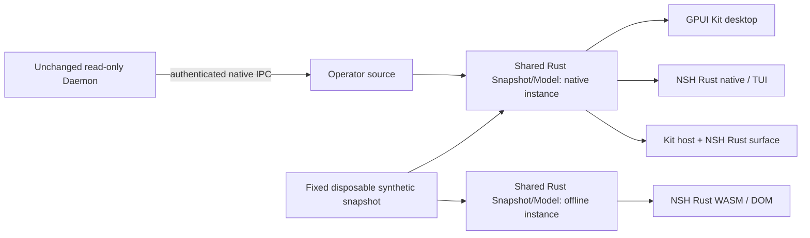
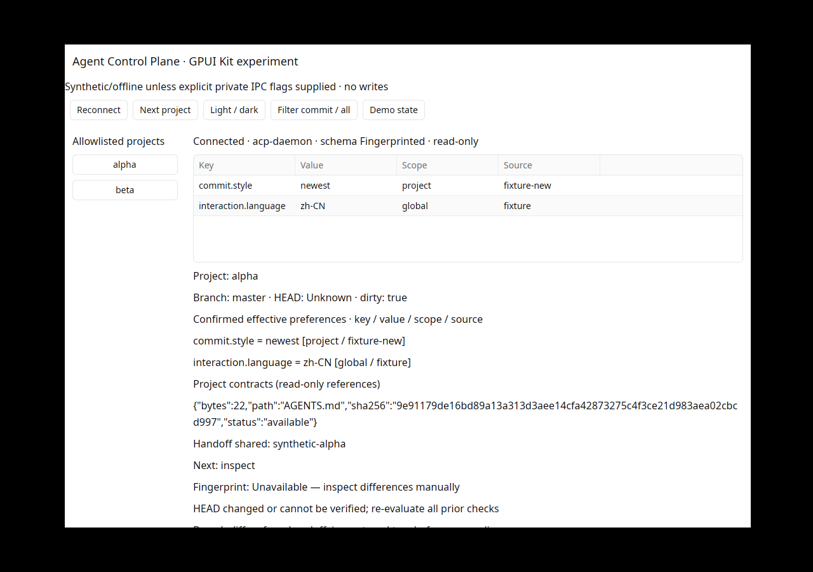
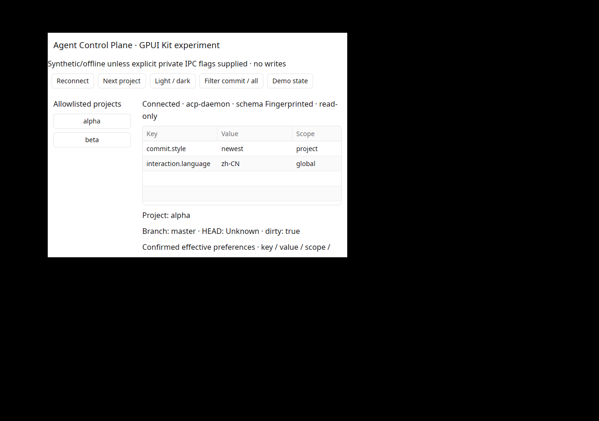
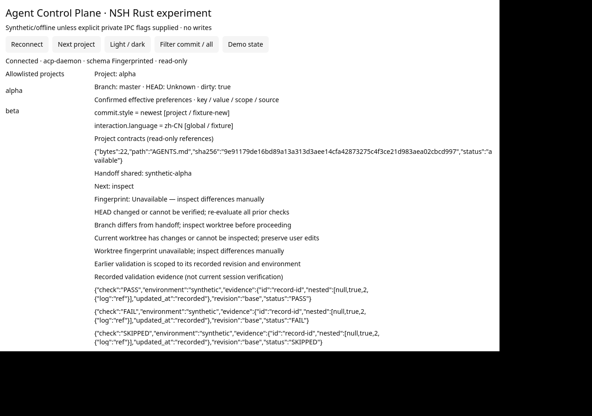
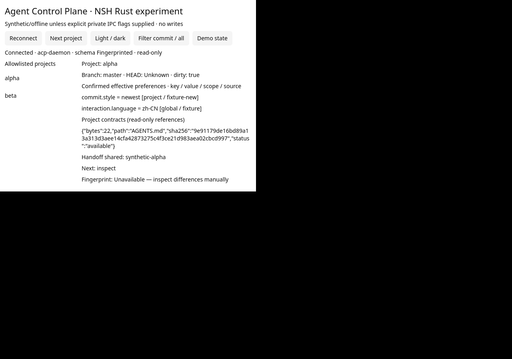
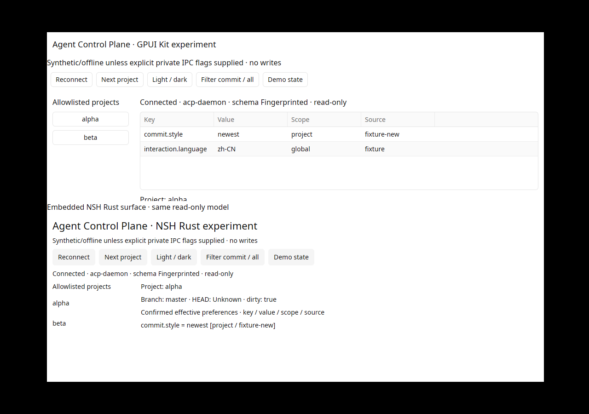
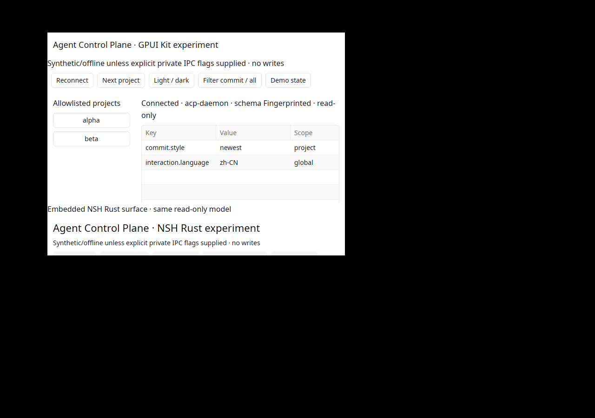
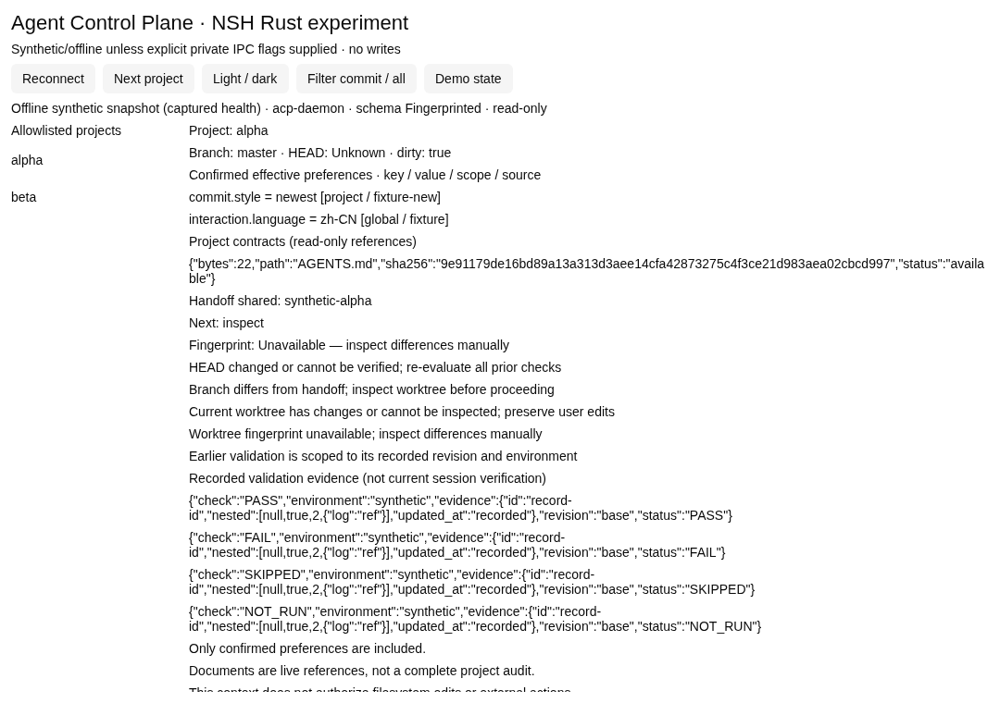
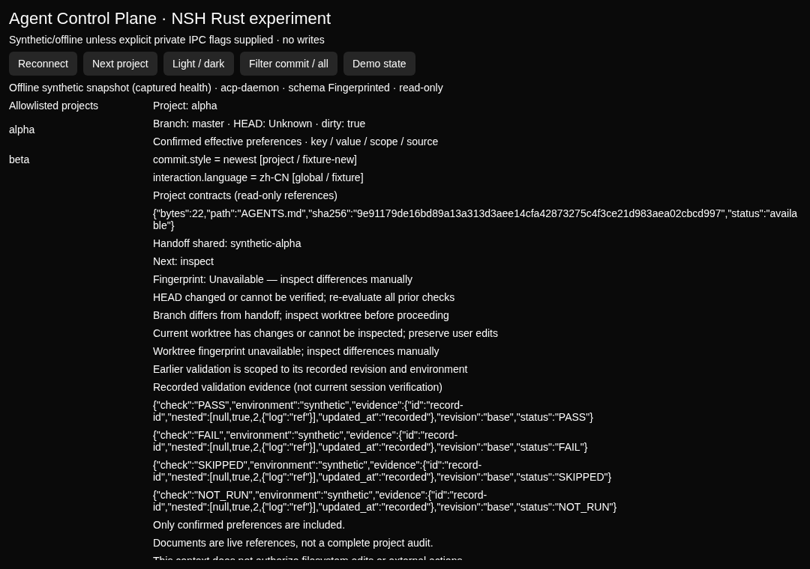

# P1-E UI framework experiment — evidence, not a framework selection

> **Historical record — not a current runbook.** Original dates, source revisions
> and outcomes below are preserved. S4 retired the executable prototype and probes;
> use [Rust-only development](rust-only-development.md) for current commands.

Issue #14, base main `d92bcadddcf33963def536698268db4996b1c889`.
Status: comparative prototype; [ADR-0003](../adr/0003-ui-framework-selection.md) is
**Proposed**. [Commands and code](../../apps/README.md).

## Frozen inputs and boundary

GPUI Kit v0.9.0 at `7591a35eced761e3613c01e71ff04c10129dae1a`, GPUI Fast
0.1.13; NSH at `87c7e8da85d2f15a56107baa6f0fabb419b508b3` (manifest 0.4.0).
Rust 1.99.1 and three independent Cargo.lock files; production manifests, lockfile,
Python CLI/MCP, core, daemon permissions, SQLite adapter and recovery are unchanged.
NSH release v0.4.0 at e626a8d has no TUI backend; the newer pinned source does.
The release CLI was downloaded, checksum verification is recorded separately, and
`nsh init <temporary-directory> --template rust` actually succeeded. It was used
for scaffolding assessment, not as the renderer of the pinned-source applications.

Pinned sources: [Kit](https://github.com/longbridge/gpui-kit/tree/7591a35eced761e3613c01e71ff04c10129dae1a),
[NSH](https://github.com/longbridge/nsh/tree/87c7e8da85d2f15a56107baa6f0fabb419b508b3).
Kit's README advertises WASM broadly, but its webassembly detail page still labels
it **showcase-only**, not a mature full-app distribution path. Its mobile guide
uses a separate compatibility fork/older renderer and warns about mismatched
GPUI types. Those claims do not become validated product targets in this report.

All frontends use the same neutral typed Snapshot/Model, fixed synthetic snapshot,
selection/filter/view-state logic and read-only workflows. Kit additionally uses
its actual DataTable and scrollbar. NSH shares one Rust component among native,
ratatui and Rust WASM/DOM; no TSX app or QuickJS feature is selected. The hybrid
loads that Rust component into `nsh_platform_gpui::AppView` in the Kit host.



There is no native-source-to-browser path. Native NSH/TUI/hybrid framework storage
is explicitly empty/in-memory and its disk image cache is off. Offline status
labels captured synthetic health instead of claiming a live daemon connection.

Native data travels through existing acp-ipc: private operator capability loading,
same-user verified transport, daemon-enforced allowlist, health/list/context/handoff
only. UI never opens SQLite or manufactures a role. Context queries explicitly
omit document contents. Unknown fingerprint is displayed as unavailable with the
existing warnings; recorded evidence is not called current session verification.
Disconnected native views clear data rather than showing a fabricated fallback.
Web contains only the fixed synthetic data and cannot authenticate to native IPC;
the test's static asset server is not a daemon API or gateway. Real profiles,
AGENT_CP_HOME, automatic daemon start and UI mutations are absent.

## Executed local experiments

Cloud: Debian 13 x86_64, Linux 6.18.57, Rust/Cargo 1.99.1, Python 3.12.14,
clang 19.1.7, GTK 4.18.6, Fontconfig 2.15, Xvfb 1280x900, Mesa lavapipe.
The environment had no display or development packages. Exact Debian packages
were downloaded with repository SHA256 verification and extracted into a
task-local sysroot; no system install or published environment edit was performed.

| Experiment | Observed result | Meaning / limitation |
| --- | --- | --- |
| Baseline Rust / Python | TEST_PASS: 32 / 21 | Before spike changes |
| Shared model tests | TEST_PASS: 3 | States, scope rejection, confirmed-only rows, 10k-row filtering |
| Native synthetic IPC model | TEST_PASS | Exact confirmed rows, evidence/warnings, unknown fingerprint; DB unchanged; daemon outlives client |
| Kit native + actual component test | BUILD_PASS / RUN_PASS / TEST_PASS | Actual X11 window; table/buttons/theme/filter/state test is separate headless input test |
| NSH Rust native + actual component test | BUILD_PASS / RUN_PASS / TEST_PASS | Actual GTK window; engine headless project/state/reconnect test |
| NSH terminal | BUILD_PASS / RUN_PASS / TEST_PASS | Actual ratatui process in PTY; Tab/Enter selects beta, resize, clean q exit |
| NSH offline web | BUILD_PASS / RUN_PASS / TEST_PASS | Actual Rust WASM + browser DOM; Chromium 156.0.8078.79, offline selection/Enter/theme/states/resize; zero external requests |
| Kit host + NSH view | BUILD_PASS / RUN_PASS on Linux | Actual NSH content inside Kit captured, not just a host window; independent selection/theme instances |
| Kit WASM showcase | BUILD_PASS with isolated nightly-2026-11-08; browser RUN BLOCKED | Default gallery builds and generates bindings; local headless probe creates canvas but assets/graphics context fail; blank canvas is not RUN_PASS |
| Shared model iOS/Android target checks | TEST_PASS (typecheck only) | Model-only checks do not validate a native UI backend |
| NSH iOS / Android component target checks | BLOCKED | Missing xcrun/Apple SDK and aarch64-linux-android-clang/NDK respectively |
| iOS simulator / Android emulator/device | NOT_RUN | No local SDK/runtime/hardware; no packaged mobile app claim |
| macOS / Windows native apps and hybrid | BUILD_PASS / RUN_PASS in final CI | All actual native windows/model/pixel probes executed; no desktop NOT_RUN fallback |

Initial Kit build failed without Fontconfig. Initial GTK rendering produced a
black screenshot when Xvfb and the client were started by different managed exec
calls: their SysV IPC namespaces differed, and Mesa reported `Failed to attach to
x11 shm`. Running the actual server and client in the **same** exec namespace
fixed rendering. That initial black frame is not RUN_PASS. The smoke now drains
diagnostics, waits for model-ready markers, rejects blank screenshots and records
native window enumeration independently of component tests.

The optional UI workflow has separate native candidate/OS jobs, component tests,
shared authenticated synthetic IPC, PTY and offline-browser gates. Production CI
is unchanged.

A final terminal-output check found that native-window readiness diagnostics were
being printed into the TUI's terminal. They are now opt-in to the native probe
only; the real PTY test asserts their absence, and clean terminal records were
regenerated. This changes probe logging, not data/authority semantics. The final
diagnostic-only code rerun is recorded in the PR separately from the 8572a24 matrix.

### Final code-run evidence

At code SHA **8572a24cee9d9bbcadf5d957e0e18a8f59582185**:

- [Optional UI run 42568211300](https://github.com/ybakiame/agent-control-plane/actions/runs/42568211300): **10/10 jobs PASS**. Logs were read, including all nine native RUN_PASS JSON records; the previously failing Windows hybrid now builds and runs.
- [Unchanged ACP Rust run 42568211443](https://github.com/ybakiame/agent-control-plane/actions/runs/42568211443): **9/9 jobs PASS**, Linux/macOS/Windows core/parity/Python, real recovery and existing local service matrices.
- [Python run 42568211486](https://github.com/ybakiame/agent-control-plane/actions/runs/42568211486): **2/2 jobs PASS**, Python 3.11 and 3.13.
- Local final root fmt / all-target/all-feature Clippy / 32 Rust tests / 21 Python tests pass. Isolated shared/Kit/NSH/hybrid Clippy and component/model tests pass. New shared model has 3 tests, each frontend 1 component-state test; real native/PTY/browser tests are separate processes.

| Candidate / target | Linux | macOS | Windows |
| --- | --- | --- | --- |
| Kit native build / run | BUILD_PASS / RUN_PASS | BUILD_PASS / RUN_PASS | BUILD_PASS / RUN_PASS |
| NSH native build / run | BUILD_PASS / RUN_PASS | BUILD_PASS / RUN_PASS | BUILD_PASS / RUN_PASS |
| Kit-hosted NSH build / run | BUILD_PASS / RUN_PASS | BUILD_PASS / RUN_PASS | BUILD_PASS / RUN_PASS |
| Real model/blank-frame/daemon-lifetime/DB-byte probe | TEST_PASS for all three | TEST_PASS for all three | TEST_PASS for all three |
| NSH actual PTY keyboard/resize | TEST_PASS | NOT_RUN | NOT_RUN |
| NSH actual offline Rust WASM/DOM | TEST_PASS (Chromium 158 CI, 156 local) | NOT_RUN | NOT_RUN |
| Physical desktop GPU, screen reader, IME | NOT_RUN | NOT_RUN | NOT_RUN |

CI OS observations: Linux 7.0 Azure/AWS with glibc 2.43 (Xvfb), macOS 26.7.2
arm64 and Windows Server 2025 10.0.26100. macOS/Windows actually enumerated
on-screen windows; none of these runs took the optional unavailable-desktop path.
This is support evidence for these runners, not every OS release or certification
of accessibility/physical GPU behavior. The [nine raw native results](ui-spike-evidence/final-ci-native-results.json)
preserve per-run timings/RSS/file sizes and source labels. Documentation-only
HEAD changes after that code SHA do not represent another native execution.

Initial optional [CI run 42560141479](https://github.com/ybakiame/agent-control-plane/actions/runs/42560141479),
at `3269ddb`, ran ten jobs: nine passed; Windows hybrid failed in wgpu-hal 29.0.4
DX12 because gpu-allocator 0.28 selected windows 0.58 while wgpu used 0.62.
All six independent native app/OS combinations actually enumerated visible windows,
loaded the synthetic authenticated model and passed nonblank screenshot checks.
Hybrid Linux/macOS and the shared IPC/PTY/offline-web job passed. It was not an
all-green run. The isolated spike lock now resolves allocator to windows 0.62.2
(within its declared range), matching the vendor NSH GPUI lock. A Windows GNU
cross-check of actual wgpu-hal/allocator DX12 types passes; this is compile-only
evidence; the final native Windows CI independently verified the fix as recorded above.

The frozen Kit web docs require nightly. Isolated nightly-2026-11-08 is Rust
1.102.0-nightly f5cedb83a; it does not change ACP's Rust 1.99.1. The Fast gallery
attempt exposed a pinned upstream fps-monitor type mismatch between gpui-pre and
gpui-fast. The documented default gallery renderer then built successfully.
Cargo.lock requires wasm-bindgen 0.2.127, despite the web docs' install example
naming 0.2.121; generated glue must match the lock, not that stale example.

The generated default-gallery module was exercised with Chromium 156/SwiftShader,
first through a static server and then the upstream Vite frontend. Its assets
point at `https://gpui-kit.com/gallery/`; the local environment could not load them
and reported `Wasm assets loading`, resource failures and a lost browser graphics
context. A local-asset mirror attempt did not establish rendered content. The
loading element disappearing / a canvas existing was explicitly rejected as
runtime proof after visual inspection of the blank frame. This is a blocked local
showcase validation, **not evidence that Kit cannot run on the Web**, and not a
claim that the ACP Kit application ships there. No failed/blank image is presented
as a successful application screenshot.

## Measurements and their limits

Measurements are unoptimized development binaries (`debug=0` for renderer apps),
with shared downloads and possible concurrent builds. They are not isolated
release or cold-OS-cache benchmarks. At code `8572a24`, clean-target compilation
used a new owned target per application and two Cargo jobs; a second identical
command measured warm no-op time. Registry downloads were cached, OS caches were
not flushed. Kit: **187.386s / 0.360s**; NSH: **116.560s / 0.223s**.
The separate hybrid fresh-target build earlier finished in 2m53s with a warm
registry. [Raw compile measurements](ui-spike-evidence/compile-measurements.json)
include commands and exit codes. Reproduce with
`python tools/measure_ui_spike_build.py --out spikes/p1-e/artifacts` after installing
the documented native dependencies.

Final local native probes at that code revision:

| Candidate | Visible window / loaded model (s) | RSS at probe (MiB) | Dev binary bytes |
| --- | --- | --- | --- |
| Kit | 0.4164 / 0.6223 | 202.51 | 177,443,864 |
| NSH GTK | 9.1685 / 9.2686 | 183.93 | 105,360,544 |
| Kit + NSH | 0.4145 / 0.6149 | 252.26 | 325,404,536 |

These are single samples. In particular GTK/Xvfb/Mesa initialization dominates the
NSH observation; it is not a general NSH startup verdict. Normal active dependency
trees on Linux contain 527 unique package lines for Kit, 318 for native NSH and
194 for offline NSH Web. All three trees contain **no SQLite or QuickJS dependency**;
the Web tree also contains no acp-ipc. Lockfiles include other targets/optional
packages, so their package counts are not equivalent to linked runtime burden.
TSX runtime/code-size differences were **NOT_RUN**; the CLI tool's own VM is not
part of the Rust applications' dependency measurements.

File size excludes shared OS libraries and does **not** represent
an installable package. Startup is from Popen to an enumerated visible window;
model-ready time is separately recorded, then RSS sampled after 0.8s. Software
rendering/namespace/cache effects confound comparisons; one sample is not a
framework performance ranking. NSH Web's final debug static assembly was
78,282,797 bytes, not an optimized shipping bundle. No 120-FPS or mobile latency
claim is made. 10k filtering is a model test, not a 10k-row renderer benchmark.

Actual screenshots and machine-readable probes are preserved under
[ui-spike-evidence](ui-spike-evidence/manifest.json), with file hashes and the
tested code revision. Native probes use authenticated **disposable** daemon data;
browser/TUI images use the fixed offline snapshot. Both follow the same schema and
visible workflow, but the source label deliberately differs. macOS/Windows CI
screenshots were generated/uploaded; local artifact download was Forbidden, so
their contents were not manually inspected. Their runtime status comes from the
explicit native-window/model/pixel probes in the CI logs, not a visual review claim.

| Actual Linux/Xvfb/native and browser captures | Narrow-window capture |
| --- | --- |
|  |  |
|  |  |
|  |  |
|  |  |

## Reproduce bounded showcase/mobile attempts

Run the pinned upstream Kit gallery from `crates/story-web`; its documented
frontend needs Bun or the equivalent npm/Vite dependencies, and WebGPU/appropriate
browser support. The exact successful module command used here was:

```sh
cargo +nightly-2026-11-08 rustc --manifest-path <pinned-kit>/Cargo.toml --locked \
  -p gpui-component-story-web --target wasm32-unknown-unknown -- \
  -C link-arg=-zstack-size=8388608
wasm-bindgen <target>/wasm32-unknown-unknown/debug/gpui_component_story_web.wasm \
  --out-dir <pinned-kit>/crates/story-web/www/src/wasm --target web --no-typescript
```

Use wasm-bindgen-cli **0.2.127** and the frozen default renderer, not the failing
Fast gallery variant. Browser asset availability and a genuinely painted frame
must still be checked; the canvas alone is insufficient.

Portable-model checks actually passed for both targets below. The corresponding
NSH component-library checks were attempted and failed at missing native SDK
compiler discovery, not declared runtime support:

```sh
rustup target add aarch64-apple-ios-sim aarch64-linux-android
cargo check --manifest-path spikes/p1-e/shared/Cargo.toml --lib --target aarch64-apple-ios-sim --locked
cargo check --manifest-path spikes/p1-e/shared/Cargo.toml --lib --target aarch64-linux-android --locked
cargo check --manifest-path spikes/p1-e/nsh/Cargo.toml --lib --target aarch64-apple-ios-sim --locked
cargo check --manifest-path spikes/p1-e/nsh/Cargo.toml --lib --target aarch64-linux-android --locked
```

To progress beyond that: Apple Silicon macOS with Xcode, selected Command Line
Tools/xcrun, an installed iOS simulator runtime and the pinned NSH mobile host;
Android SDK/platform-tools, NDK LLVM toolchain (set target CC/AR/linker), an API
28+ runtime/device and the NSH Android wrapper/package tools. This repository's
standalone `native` binary is desktop-only; a model/component typecheck does not
produce an IPA/APK or validate a platform view. No simulator, emulator, signed
package, mobile accessibility or physical device was run in this PR.

## Weighted comparison and falsifiable recommendation

| Dimension | Weight | Kit | NSH Rust | Kit + NSH |
| --- | --- | --- | --- | --- |
| Desktop usability/density/accessibility | 30% | Real styled/virtualized table and component input tests; screen-reader/IME NOT_RUN | Shared two-pane inspector, buttons/labels; no equivalent 10k table trial; screen-reader/IME NOT_RUN | Host/embedded interactions need explicit focus/theme tests |
| IPC/security integration | 25% | Same authenticated operator model, read-only | Same model on native/TUI; web intentionally offline | Same source contract; no new daemon power |
| Multi-target reuse | 20% | Desktop executed locally; WASM showcase blocked; mobile separate experimental baseline | Actual shared Rust native/TUI/offline Web; mobile SDK checks blocked | NSH surface reuse demonstrated separately from host portability |
| Build/packaging/maintenance/churn | 15% | Large desktop graph; pinned facade and Fast backend | New commit required for TUI; Linux GTK/GStreamer; no JS VM selected | Both graphs; GPUI Fast alignment required; extra integration ownership |
| Startup/RSS/size/responsiveness | 10% | Probe evidence only | Probe evidence only | Probe evidence only; no repeat/release parity |

Do not sum unknowns into a numerical winner. Provisional recommendation: continue
NSH Rust as the multi-target candidate, keep Kit as the desktop-density benchmark,
and retain the hybrid only if its rich host controls justify its additional cost.
No framework is accepted. Counterevidence includes a development-only TUI baseline,
unverified accessibility, GTK dependency/package cost and missing mobile runtime.
TSX was not benchmarked: no claim that Rust is universally smaller/faster or that
TSX hot updates justify its VM is made.

Next acceptance experiments: identical 10k-row renderer workloads, full keyboard
and focus assertions on each actual OS, IME and screen readers, repeated isolated
release startup/RSS/package sizes and clean-machine installation; mobile wrapper
builds and simulator launches with the pinned NSH CLI/source and actual SDKs;
host/surface theme/focus/unmount tests for the hybrid. Reconsider this provisional
ordering if NSH cannot meet dense desktop/accessibility goals or if Kit's packaging
cost outweighs its table benefits. Authenticated browser data needs its own security
design; do not add a convenience TCP proxy to improve the comparison score.
